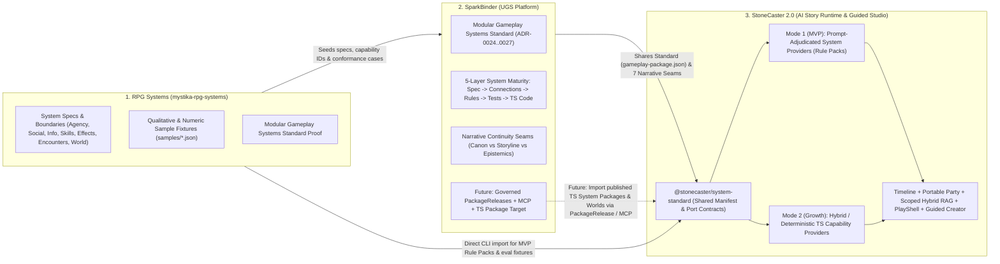
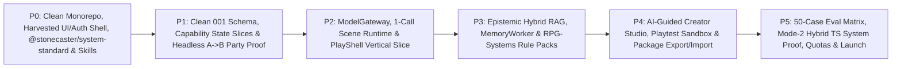

# StoneCaster 2.0 — Clean-Slate & Ecosystem Implementation Plan (v2)

**Branch:** `stonecaster-2.0` (standalone trunk — `main` untouched at `0ba046db`)  
**Date:** 2026-10-31  
**Coordinated Repos Inspected:**
- `c:\Dev\Stone Caster\stone-caster-2` (current StoneCaster monorepo + [`stonecaster2-design`](file:///C:/Dev/Stone%20Caster/stone-caster-2/docs/Stonecaster_2_0/stonecaster2-design/00_START_HERE.md))
- `c:\Dev\RPG Systems\mystika-rpg-systems` ([`README.md`](file:///C:/Dev/RPG%20Systems/mystika-rpg-systems/README.md), [`architecture.md`](file:///C:/Dev/RPG%20Systems/mystika-rpg-systems/docs/architecture.md), [`modular-gameplay-systems-standard.md`](file:///C:/Dev/RPG%20Systems/mystika-rpg-systems/docs/modular-gameplay-systems-standard.md), [`modular-standard-proof`](file:///C:/Dev/RPG%20Systems/mystika-rpg-systems/reference/modular-standard-proof/packages/contracts/package.json))
- `c:\Dev\SparkBinder` ([`PROJECT_STATE.md`](file:///C:/Dev/SparkBinder/docs/PROJECT_STATE.md), [`SYSTEM_MATURITY_PATH_OWNER_DIRECTION.md`](file:///C:/Dev/SparkBinder/docs/reviews/SYSTEM_MATURITY_PATH_OWNER_DIRECTION.md), [`ADR-0024`](file:///C:/Dev/SparkBinder/docs/architecture/ADR/ADR-0024-modular-gameplay-system-model.md)–[`ADR-0027`](file:///C:/Dev/SparkBinder/docs/architecture/ADR/ADR-0027-typescript-package-build-target.md), [`NARRATIVE_CONTINUITY_NORTH_STAR_CANDIDATE.md`](file:///C:/Dev/SparkBinder/docs/ed-input/NARRATIVE_CONTINUITY_NORTH_STAR_CANDIDATE.md))

---

## 1. Strategic Verdict: Should We Start From Scratch and Harvest?

**Yes — unequivocally.** Knowing that StoneCaster has **no live production user base or legacy saves to preserve** changes the optimal engineering path completely.

In our initial evaluation, the only reason to build inside the existing `stone-caster-2` tree was to avoid breaking assumed live saves. Without that constraint, keeping `stone-caster-2`'s existing tree means paying a massive tax on every task:
- **5 overlapping code generations** (orphaned `src/`, dead AWF folders querying deleted tables, broken `game-v3`, Chimera 2-LLM + D100 `EngineService`, and F0a/F0b git-blob sync).
- **19 historical SQL migrations** built around `save === compiled_story` (`chimera_game_states`) and nullable character worlds.
- **Heavy legacy suppression debt:** 1,834 frozen baseline files, 849 baselined TypeScript errors, 1,067 Knip issues, 562 ESLint-suppressed files, Vitest 1.0, and Node 20/24 drift.
- **29 `always_on` agent rules + 14 Cursor rules** containing Chimera mandates, `pnpm`/`npm` contradictions, and PowerShell-corrupted markdown.

> [!IMPORTANT]
> **Recommended Strategy — "Clean-Slate Modern Monorepo + Selective Harvest":**
> Start StoneCaster 2.0 from a **zero-debt modern TypeScript workspace** (matching [`SparkBinder`](file:///C:/Dev/SparkBinder/package.json)'s clean toolchain: Node 24, `pnpm` + `turbo`, TypeScript 5.9 `strict` with **zero** suppression baselines, ESLint 9, Vitest 3, Playwright + `axe`, and a fresh `001` Postgres schema), while **harvesting the ~20% of `stone-caster-2` that is genuinely high value** alongside contracts and patterns from `SparkBinder` and `RPG Systems`.

### Two Ways to Host the Clean Slate

| Container Option | How It Works | Pros / Trade-offs |
|---|---|---|
| **Option 2A: Clean-Slate Reset on `stonecaster-2.0` Branch** *(in this repo)* | Clear legacy v1 directories on `stonecaster-2.0` (leaving `main` 100% intact as a frozen donor archive) and lay down the clean monorepo + `docs/Stonecaster_2_0/`. | Keeps single GitHub repo (`Daakon/stone-caster-2`); instant `git show main:<path>` harvesting; when happy, `stonecaster-2.0` simply replaces `main`. Requires branch/deploy fences until cutover. |
| **Option 2B: Fresh Sibling Repository** *(e.g. `c:\Dev\StoneCaster-2`)* | Initialize a brand-new git repo at top level `c:\Dev\StoneCaster-2` (fixing the nested `Stone Caster\stone-caster-2` folder quirk) and copy `docs/Stonecaster_2_0/` + harvested donor modules across on disk. | **Zero** risk of ever merging into or deploying over v1 `main`; clean `git log` from commit #1; matches `c:\Dev\SparkBinder` layout directly. Requires pointing a new GitHub repo when ready to push. |

*(Both options execute the exact same architecture and roadmap below; Option 2B is slightly cleaner ergonomically, while Option 2A fulfills keeping everything on a standalone branch inside the current repo.)*

---

## 2. Coordinating `RPG Systems` ↔ `SparkBinder` ↔ `StoneCaster 2.0`

Inspecting [`mystika-rpg-systems`](file:///C:/Dev/RPG%20Systems/mystika-rpg-systems/README.md) and [`SparkBinder`](file:///C:/Dev/SparkBinder/docs/PROJECT_STATE.md) revealed a **natural three-part architecture** that solves your exact goal: **ship the simpler prompt-driven StoneCaster 2.0 vision fast today, while allowing deep deterministic or hybrid RPG systems (like Mystika or current StoneCaster mechanics) to plug in cleanly over time without another rewrite.**

### 2.1 Clear Role of Each Project (Zero Blocking Dependencies)



> [!TIP]
> **Why This Avoids Slowing Down StoneCaster 2.0:**
> `SparkBinder` has a disciplined 57-packet roadmap (`UX-1` active; `B1-006` SystemContracts and `ADR-0027` TypeScript codegen still ahead). StoneCaster 2.0 **must not block** waiting for SparkBinder packets to ship. Instead, StoneCaster 2.0 adopts SparkBinder's **accepted data/contract standard now** (`modular-gameplay/package@1` from [`ADR-0024`](file:///C:/Dev/SparkBinder/docs/architecture/ADR/ADR-0024-modular-gameplay-system-model.md) + [`ADR-0027`](file:///C:/Dev/SparkBinder/docs/architecture/ADR/ADR-0027-typescript-package-build-target.md) and the 7 seams in [`NARRATIVE_CONTINUITY_NORTH_STAR_CANDIDATE.md`](file:///C:/Dev/SparkBinder/docs/ed-input/NARRATIVE_CONTINUITY_NORTH_STAR_CANDIDATE.md#L83-L94)). What we prove in StoneCaster 2.0's runtime can feed straight back into SparkBinder when those packets activate!

### 2.2 The Unifying Seam: "Capability-Backed Rule Packs" (Bridging Simple AI Prompts Today → Deep Systems Tomorrow)

In [`SYSTEM_MATURITY_PATH_OWNER_DIRECTION.md`](file:///C:/Dev/SparkBinder/docs/reviews/SYSTEM_MATURITY_PATH_OWNER_DIRECTION.md#L13-L19), you established that every gameplay system grows through five layers (**`Spec → Connections → Rules → Tests → Code`**) and that **unfinished/qualitative is a valid first-class state** (`Tiers 1..N`, `Types A/B`, and **Neutral Defaults** when unwired).

By modeling StoneCaster 2.0's **Rule Packs** as **Modular Gameplay System Packages** (`@stonecaster/system-standard`), one unified runtime supports the entire spectrum of complexity:

| System Maturity / Mode | What the Creator / Package Supplies | How StoneCaster 2.0 Executes It | When Used |
|---|---|---|---|
| **Mode 0: Unwired (Neutral Default)** | Nothing (system not enabled by World or Scenario) | Capability port returns its declared **Neutral Default** (e.g., no `Inventory` pack → gear is purely narrative flavor). | Minimalist story worlds |
| **Mode 1: Prompt Provider (`Tier 1–2` Rule Pack)** | **Spec + Optional State Slice Schema + Allowed Events + Prompt Instructions + Worked Examples** (authored in plain English via Creator Studio or imported from `RPG Systems` markdown) | `PromptCompiler` injects the pack when `activationHints` match; Scene LLM adjudicates consequences in fiction and proposes typed `Events`; `OutcomeValidator` checks schema, actor permissions, and capability-owned state bounds. **Zero coded RPG math.** | **StoneCaster 2.0 MVP default** (`NPC Agency`, `Social/Relationships`, `Abilities`, `Tactical Conflict`) |
| **Mode 2: Hybrid / Declarative / Code Provider (`Tier 2–3` System Package)** | Adds **TypeScript `CapabilityProvider`** (`validate`, `gatherModifiers`, `resolve`, `reserve/commit` from [`modular-standard-proof`](file:///C:/Dev/RPG%20Systems/mystika-rpg-systems/reference/modular-standard-proof/packages/ability-coordinator/gameplay-package.json) / SparkBinder `ADR-0027`) + Conformance Kit | During the turn (`Intent → Validate → Contributions → Reaction → Resolve → Commit → Event`), Node executes the TypeScript provider (either as LLM tool calls or deterministic pre/post-resolution hooks) and feeds verified mechanical facts + modifiers to the Scene LLM for narration! | **Long-term expansion** (`mystika-core-skills-resolution`, strict Inventory/Crafting reservations, Injury/Status, World Calendar/Simulation) |

### 2.3 Preserving SparkBinder's 7 Narrative Continuity Seams in StoneCaster 2.0's Core Schema

Aligning StoneCaster 2.0's Postgres schema with [`NARRATIVE_CONTINUITY_NORTH_STAR_CANDIDATE.md`](file:///C:/Dev/SparkBinder/docs/ed-input/NARRATIVE_CONTINUITY_NORTH_STAR_CANDIDATE.md#L34-L47) ensures Worlds, Lore, NPCs, and Arcs/Scenarios can later round-trip cleanly between SparkBinder and StoneCaster:

1. **Single-Owner Capability State Slices:** Instead of one untyped `state` JSONB blob on `Timeline`, `PlayerCharacter`, and `NpcInstance`, partition mutable state by capability ID (`capability_state: Record<CapabilityId, unknown>`). Only events authorized by that capability's contract can mutate its slice.
2. **Definition ≠ Occurrence:** Published `World`, `NpcDefinition`, `ScenarioDefinition`, `LoreItem`, and `SystemPackage` revisions are immutable definitions; `TimelineEvent` records occurrences on one specific player `Timeline`.
3. **Typed Lore & Entity Relations:** Reference `(resource_id, revision)` via typed edges (`subject`, `target`, `relation_kind`), never loose free-text names.
4. **"Players Are Two Knowers" + Epistemic Provenance:** Separate `world_fact` (canon), `timeline_fact` (occurred), `character_claim` (`known` vs `belief` with `truth_status` + `source_event_id` for NPCs *and* the Player Character), and `player_reveal` (what the human player's UI dossier/journal is allowed to show).
5. **World-Relative Temporal Anchor:** Store optional structured temporal placement (`{ calendarId?, era?, ordinal?, displayLabel }`) on events/lore rather than forcing real-world timestamps for in-world history.

---

## 3. Designing for Rapid AI Evolution (2026–2028)

StoneCaster v1/Chimera aged poorly because it encoded 2024-era LLM workarounds (`Jev` closed-set classifier → `MAS-1` JSON interpreter → hardcoded D100 math → `MAS-2` constrained narrator) directly into domain state and UI. StoneCaster 2.0 isolates volatile AI capabilities behind **five replaceable seams**:

1. **`TurnExecutionStrategy` Interface (1-Call Default, Pluggable Deliberation):**
   - **MVP Default (`SingleSceneStrategy`):** One structured-output call to a strong model handles cast agency, dialogue, narration, and proposed events simultaneously.
   - **Future Drop-Ins:** `ToolCallingSceneStrategy` (LLM calls deterministic `Mode 2` TypeScript system packages mid-turn), `PlanAndVoiceStrategy` (strict epistemic redaction between director plan and NPC dialogue), or `StreamingAudioSceneStrategy`—all emitting the identical `ProposedTurn` contract into `OutcomeValidator`.
2. **Prefix-Cached `PromptCompiler`:**
   - Orders prompt blocks strictly from most-static to most-dynamic (`Platform Contract` → `Pinned World + System/RulePack Revisions` → `Scenario + Cast` → `Scoped RAG & Capability State` → `Recent Turns + Action`) to hit 75–90% provider prompt-cache discounts automatically across Anthropic, OpenAI, Google, and OpenRouter.
3. **Capability-Driven `ModelGateway` (Zero Hardcoded Model Names or Prices):**
   - Routes by abstract profile (`standard`, `premium`, `fast_aux`, `creator`, `embedding`) backed by DB/config capability metadata (`structuredOutput`, `promptCaching`, `toolUse`, `reasoningEffort`, `contextWindow`, token rates). Adding a 2027 frontier model = adding config + running the eval gate.
4. **Derived-Only Embeddings & Compaction (`Event Log = Source of Truth`):**
   - `timeline_events`, `relationships`, and `character_claims` are canonical SQL records; `knowledge_chunks` (`tsvector` + `pgvector`) and rolling summaries are **100% rebuildable caches**. Switching embedding dimensions/models or expanding context budgets never corrupts saves.
5. **Automated Conformance & Eval Harness (`Vitest` + `Promptfoo`):**
   - Every model upgrade or new System/Rule Pack runs against reproducible fixtures (including `RPG Systems` `samples/*.json` and the 50-case continuity/epistemic/agency corpus) so you can empirically measure when a single model call outperforms multi-step pipelines (or vice versa).

---

## 4. Concrete Harvest Map Across Your Local Repos

| Source Repo | What We Harvest | What We Leave Behind |
|---|---|---|
| **`stone-caster-2`** | • [`tokens.css`](file:///C:/Dev/Stone%20Caster/stone-caster-2/docs/design/play-redesign/tokens.css), Tailwind literary theme (`Fraunces`, `Newsreader`, `DM Sans`), `check-design-tokens.mjs`, `shadcn/ui` primitives<br>• Phase 0 [`PlayShell.tsx`](file:///C:/Dev/Stone%20Caster/stone-caster-2/frontend/src/features/play/components/PlayShell.tsx), `ThreeColumnLayout`, `SlimRail`, `CastStack`, `PlayComposer` (decoupled from Chimera)<br>• Supabase Auth/JWT verification, Cloudflare Images uploader, `AsyncLocalStorage` LLM telemetry<br>• Mystika world/NPC/lore prose from `content/first-party/` as optional seed content | All Gen 0–4 backend engines (`AWF`, `game-v3`, `DirectorService`, `EngineService`, `Mas2Service`, `JevShadowService`), `CastingCircleWizard`, F0a/F0b git-blob sync, 19 Chimera SQL migrations, and 1,834-file suppression baselines |
| **`SparkBinder`** | • Clean workspace architecture & scripts (`Node 24`, `pnpm`, `turbo`, `TS 5.9 strict`, `ESLint 9`, `Vitest 3`, `Playwright` + `axe`, inward dependency guardrails)<br>• `Modular Gameplay Systems Standard` (`ADR-0024`–`0027`) port/maturity concepts & Narrative Continuity epistemic model<br>• Crisp `<500`-line `skills/<name>/SKILL.md` agent skill structure | Heavyweight 57-packet gate ceremony, AWS CDK/Fastify/Alembic stack, spreadsheet/ChangeSet review inbox, full marketplace commerce |
| **`RPG Systems`** | • [`modular-standard-proof`](file:///C:/Dev/RPG%20Systems/mystika-rpg-systems/reference/modular-standard-proof/packages/contracts/src/index.ts) TypeScript contracts, `gameplay-package.schema.json`, and conformance runner pattern<br>• Core domain boundaries & initial Rule Pack content from `systems/{agency-behavior,social,information,character,skills,effects,encounters,world-rules}` + `samples/*.json` | Unfinished town-governance layer (`settlement-governance`) and unresolved `TBD` math formulas until ready |

### Proposed Clean-Slate Monorepo Layout

```text
stonecaster-2/
├── apps/
│   ├── web/                     # React 19 + Vite + Tailwind + tokens.css + PlayShell + Creator Studio (Cloudflare Worker)
│   └── api/                     # Node 24 + Express/Fastify thin HTTP routes + SSE/JSON turn endpoints (Fly.io)
├── packages/
│   ├── system-standard/         # Shared Modular Gameplay Systems Standard (manifests, capability IDs, Mode 1/2 provider contracts, conformance runner — SparkBinder & RPG Systems compatible!)
│   ├── contracts/               # Shared Zod schemas & API DTOs (Worlds, Characters, Timelines, Parties, Scenarios, Events, Epistemics)
│   ├── runtime/                 # TimelineService, ScenarioService, PartyService, ContextOrchestrator, RulePackResolver, PromptCompiler, SceneOrchestrator, OutcomeValidator, MemoryWorker
│   ├── model-gateway/           # Provider-neutral AI adapters (OpenAI, Anthropic, Google, OpenRouter, Mock) + cost/cache telemetry
│   ├── persistence/             # Supabase Postgres client, typed repositories, atomic sc2_commit_turn RPC, hybrid FTS+pgvector queries
│   └── default-systems/         # Starter System/Rule Packs (NPC Agency, Social/Relationships, Abilities, Tactical Conflict) + RPG Systems importer
├── supabase/
│   ├── config.toml              # Isolated local Docker stack (project_id = "stonecaster-v2")
│   ├── migrations/              # Clean 001+ SQL schema, RLS policies, hybrid search & atomic turn commit RPCs
│   └── seed/                    # Emberlight Academy vertical-slice seed + imported Mystika sample seed
├── evals/                       # Vitest deterministic conformance + Promptfoo 50-case model/rule-pack evaluation suite
├── skills/                      # Canonical cross-agent SKILL.md files (mirrored/linked into .agents/skills/)
└── docs/Stonecaster_2_0/        # Authoritative design pack + ADRs
```

---

## 5. Infrastructure, AI Skills/Instructions & Deployment Pipelines (Clean-Slate Edition)

Starting clean eliminates 90% of the CI/deployment workarounds required by the legacy codebase while keeping strict safety fences:

1. **Zero-Baseline Strict CI Pipeline (`.github/workflows/ci.yml`):**
   - Runs on `stonecaster-2.0` (or `main` if in a fresh sibling repo) with **Node 24** and **zero legacy suppression files**: `format:check → lint (ESLint 9 + jsx-a11y + design-tokens) → typecheck (TS 5.9 strict) → architecture:check (inward package boundaries) → test (Vitest unit + local Postgres RLS/atomic-turn integration) → test:e2e (Playwright 390/1100/1440 + axe)`.
   - Separate `evals.yml` workflow (manual / model-or-rulepack path trigger) running `Promptfoo` conformance suites.
2. **Complete Environment & Deployment Isolation:**
   - **Local Dev:** Single command (`pnpm dev` / `pnpm db:up`) always boots against isolated local Docker Supabase (`stonecaster-v2`), never touching v1 `.env` or hosted `obfadjnywufemhhhcxiy`. Startup config includes a hard deny-list fence rejecting the v1 Supabase project ref.
   - **Hosted Staging & Prod (`v2` Dedicated Resources):**
     - **Supabase:** Fresh `stonecaster-v2` project (clean Auth, Storage, `pgvector` HNSW, `tsvector` GIN, RLS).
     - **Fly.io:** `fly.toml` targeting `stonecaster-v2-api` on `node:24-alpine` (with branch/target preflight check in deploy scripts; no manual PowerShell scripts with hardcoded v1 secrets).
     - **Cloudflare Workers:** `wrangler.toml` targeting `stonecaster-v2-web` (`workers.dev` preview first; custom domain cutover only when ready).
   - **MCP & Secret Hygiene:** Strict `.gitignore` (`.env*` except `.env.example`/`.env.local-demo`, `.claude/*.local.json`, `/tmp/`), plus read-only/docs-only `.mcp.json` by default so agents never run live DDL against hosted databases.
3. **Clean AI Agent Governance (`AGENTS.md` + `skills/<name>/SKILL.md`):**
   - One concise root `AGENTS.md` (with thin `CLAUDE.md`, `GEMINI.md`, and `.cursor/rules/` pointers—just like `SparkBinder`), replacing all 43 legacy/corrupted `.agent` and `.cursor` rule files.
   - **7 Focused Progressive-Disclosure Skills** in `skills/` (and `.agents/skills/` for automatic Antigravity discovery):
     1. `sc2-architecture-boundaries` — package dependency direction, Definition vs. Instance, and Narrative vs. Persistence authority.
     2. `sc2-system-standard-and-packs` — authoring Mode 1 (Prompt) and Mode 2 (Hybrid/TS) System Packages compatible with `RPG Systems` & `SparkBinder`.
     3. `sc2-persistence-and-epistemics` — SQL migrations, RLS, atomic `commit_turn` RPC, capability state slices, and `world_fact`/`character_claim`/`player_reveal` boundaries.
     4. `sc2-context-rag-and-evals` — hybrid `tsvector` + `pgvector` RRF retrieval, untrusted-lore quoting, cache-aligned prompt compilation, and `Promptfoo` evals.
     5. `sc2-mobile-play-and-studio-ux` — `390×844` mobile-first layout, `tokens.css`, harvested `PlayShell`, Creator Studio flows, Playwright + `axe`.
     6. `sc2-local-dev-and-testing` — one-command local Supabase/Postgres lifecycle, deterministic Mock AI fixtures, and conformance testing.
     7. `sc2-release-and-deploy` — guarded deployment to `stonecaster-v2` staging/prod, model profile verification, and cost-budget checks.

---

## 6. Streamlined Phased Roadmap (`P0` → `P5`)

Starting from a clean slate removes the legacy strangler/cleanup phase completely and gets to playable software much faster:



- **Phase P0 — Clean-Slate Workspace, Harvested Shell, `@stonecaster/system-standard` & AI Tooling:**
  Stand up the clean Node 24 + `pnpm` + `turbo` monorepo (`apps/{web,api}`, `packages/*`), harvest `tokens.css` + `shadcn/ui` + decoupled `PlayShell` + Supabase Auth/Telemetry, implement `@stonecaster/system-standard` (`modular-gameplay/package@1` contracts + Mode 1/Mode 2 provider interface), wire zero-suppression CI gates, and install the new `AGENTS.md` + 7 `SKILL.md` skills.
- **Phase P1 — Core Domain, Capability-Partitioned Persistence & Headless Scenario A → B Proof:**
  Write clean `001_sc2_core.sql` (immutable revisions for Worlds/NPCs/Scenarios/SystemPackages; `PlayerCharacters`, `Timelines`, `NpcInstances`, `PartyMemberships`, `ScenarioRuns`, capability-keyed state slices, SparkBinder-aligned epistemic claims, and atomic `sc2_commit_turn` RPC). Seed `Emberlight Academy` (`Rowan`, `Lyra`, `Tessa`, `Provost Merin`, Scenarios A & B) and pass headless A→B portable-party & timeline isolation gates (`ID-01`, `TL-01`, `NPC-01`, `NPC-03`, `SC-01..03`, `RT-01`).
- **Phase P2 — `ModelGateway`, Single-Call Story Runtime & Interactive Player UX:**
  Implement `ModelGateway` (OpenAI, Anthropic, Google, OpenRouter, Mock + cache/cost ledger), `SingleSceneStrategy` + `OutcomeValidator`, and the full `390px` Player UX (`Discover → World → Character/Timeline → Party & Scenario Preflight → PlayShell with actor dialogue/threads/journal → Outcome Summary`). Pass interactive A→B playtesting (`NPC-02`, `RT-02`, `MOD-01`, `UX-01`).
- **Phase P3 — Scoped Hybrid RAG, Epistemic Memory & `RPG Systems`-Backed Rule Packs:**
  Add `knowledge_chunks` (`tsvector` GIN + `pgvector` HNSW + RRF) with pre-retrieval epistemic filtering (`world_fact` vs `character_claim` vs `creator_secret`), async `MemoryWorker`, prefix-cached `PromptCompiler`, and starter System/Rule Packs seeded from `RPG Systems` (`agency-behavior`, `social`, `skills`, `encounters`) + *"Why did this NPC say that?"* inspector (`KNOW-01..02`, `RAG-01`, `RULE-01..02`).
- **Phase P4 — Guided Creator Studio, Sandbox Playtest & Ecosystem Package Portability:**
  Build the 4-entry Creator Studio (`World`, `NPC`, `Scenario`, `System / Rule Pack`) with `Quick / Guided / Advanced` Chat + Structured Cards, 10 ACL-checked assistant tools, disposable Sandbox Playtest, Publish Wizard, and import/export of `gameplay-package.json` manifests so content & systems move cleanly between `RPG Systems`, `SparkBinder`, and `StoneCaster 2.0` (`CR-01..02`).
- **Phase P5 — Eval Corpus, Mode 2 Hybrid TypeScript Provider Proof, Cost Quotas & Launch:**
  Run the 50-case `Promptfoo` + `Vitest` evaluation suite across model profiles; **prove long-term extensibility by plugging in one real Mode 2 TypeScript `CapabilityProvider`** (e.g., `RPG Systems` `inventory-reservation` or `mystika-core-skills-resolution` running alongside prompt packs without touching `Timeline` or `PlayShell`!); enable model/token usage budgets and deploy to dedicated `stonecaster-v2` staging/prod.

---

## 7. Decisions to Lock Before Breaking Down Phase P0

1. **Clean-Slate Container — `Option 2A` (Clean-Slate Reset on `stonecaster-2.0` Branch) vs. `Option 2B` (Fresh Sibling Repo `c:\Dev\StoneCaster-2`):**
   - Do you want to wipe the legacy files on the standalone `stonecaster-2.0` branch inside this repo (keeping `main` untouched as a donor archive), **or** initialize a brand-new sibling repository at `c:\Dev\StoneCaster-2` (matching `c:\Dev\SparkBinder` with zero legacy git baggage)?
2. **Toolchain Alignment with `SparkBinder` (`pnpm` + `Turborepo` + `Node 24`):**
   - Since `SparkBinder` already runs `Node 24` + `pnpm` + `Turborepo` + `TS 5.9` + `ESLint 9` + `Vitest 3`, aligning StoneCaster 2.0 to that exact workspace toolchain makes sharing `@stonecaster/system-standard` (or future `@sparkbinder/*` packages) frictionless. Confirm you're happy adopting **`pnpm` + `Turborepo` + `Node 24`** for the clean slate?
3. **API Server Framework (`Express` vs. `Fastify`):**
   - `stone-caster-2` used Express 4; `SparkBinder` uses Fastify (faster, native schema/TypeScript ergonomics, cleaner plugin isolation). Since routes are thin adapters over `packages/runtime`, either is easy—do you prefer **Fastify** (matching `SparkBinder`) or **Express 5 / Hono**?
4. **`RPG Systems` → `StoneCaster 2.0` Bridge Scope in MVP:**
   - Confirm you like the **Dual-Mode `@stonecaster/system-standard` design** (where MVP ships fast using **Mode 1 Prompt Rule Packs** seeded from `RPG Systems` specs, and **Phase P5 proves one Mode 2 TypeScript `CapabilityProvider`** so you know for certain deeper Mystika/SparkBinder systems can plug in cleanly later)?
