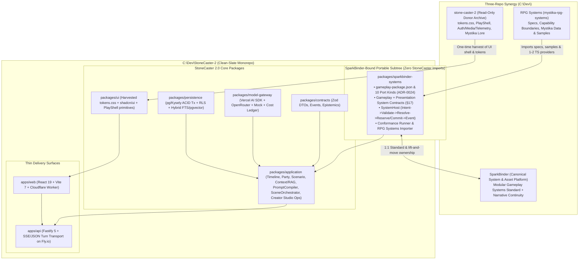
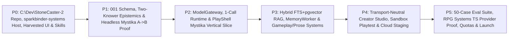

# StoneCaster 2.0 — Master Implementation Plan (v3 — Locked via `/grill-me`)

**Status:** All 12 core architectural & ecosystem decisions resolved — ready for approval & Phase P0 task breakdown  
**Target Repository:** New clean-slate sibling repo `C:\Dev\StoneCaster-2` *(to be initialized on P0 kickoff)*  
**Donor / Archive State:** `C:\Dev\Stone Caster\stone-caster-2` kept frozen (`main` untouched at `0ba046db`; design pack + this plan tracked on standalone branch `stonecaster-2.0`)

---

## 1. Locked Architecture & Ecosystem Decisions Summary

| # | Decision Area | Locked Direction |
|---|---|---|
| **D1** | **Repository & Clean-Slate Container** | Initialize a **brand-new sibling repository (`C:\Dev\StoneCaster-2`)**. Keep `C:\Dev\Stone Caster\stone-caster-2` frozen as a read-only donor archive (zero legacy suppression debt, zero risk of merging/deploying to v1 `main`). |
| **D2** | **`SparkBinder` as Canonical System Owner** | Place all shared system contracts, manifests, conformance kits, and `SystemHost` orchestration inside a **zero-StoneCaster-dependency package subtree (`packages/sparkbinder-systems/`)** using generic SparkBinder vocabulary so it lifts directly into [`SparkBinder`](file:///C:/Dev/SparkBinder/docs/PROJECT_STATE.md) once SparkBinder's system packets open. |
| **D3** | **Unified 5-Layer System Model (Gameplay + Presentation)** | Model **both** gameplay domains (`Agency`, `Social`, `Character/Skills`, `Effects`, `Encounters`, `World Rules`, `Information`) **and** **Presentation / Narrative Direction** (`prose/tone/pacing/voice/dramatic-irony`, owning zero gameplay state per Modular Standard §17) as governed SparkBinder-shaped Systems (`Spec → Connections → Rules → Tests → Code` + AI prompt profile) so SparkBinder users can capitalize on AI Narrative/Prose systems too. |
| **D4** | **Dual-Mode `SystemHost` Lifecycle from Day 1** | Implement `Intent → Validate → Gather Contributions → Reaction Window → Resolve → Reserve/Commit → Event` from Day 1 so **Mode 1 (Prompt-Adjudicated Rules)** and **Mode 2 (Deterministic TypeScript `CapabilityProvider`s)** execute side-by-side in the same turn. Ship MVP primarily with prompt-backed systems plus **1–2 TypeScript providers from [`RPG Systems`](file:///C:/Dev/RPG%20Systems/mystika-rpg-systems/README.md)** as proof. |
| **D5** | **Tech Stack, Server, Auth & Persistence** | Match SparkBinder's workspace & API stack (**`Node 24`, `pnpm`, `Turborepo`, `TypeScript 5.9 strict`, `Fastify 5`, transactional `pg`/`Kysely` SQL with per-transaction RLS context**) paired with StoneCaster's low-ops cloud stack (**Supabase Auth + Supabase Postgres 17/`pgvector` + Fly.io + Cloudflare Workers**). |
| **D6** | **`ModelGateway` & `Jev` Posture** | Clean `ModelGateway` port backed internally by **Vercel AI SDK** (`OpenAI`, `Anthropic`, `Google`, `OpenRouter` + deterministic `Mock`). Default to **1 scene-model call per routine turn** with prefix-cached prompts; keep `Jev` strictly optional/eval-only. |
| **D7** | **MVP Vertical Slice World** | Build `P1`–`P3` on a **compact 2-scenario `Mystika` adventure slice** (testing `RPG Systems` + Mystika canon directly) paired with a tiny **synthetic Vitest world fixture** to enforce 100% world-agnosticism in code. |
| **D8** | **Transport-Neutral Application Layer & MCP** | Build all gameplay and Creator Studio (10 assistant tools) logic in `packages/application` as **transport-neutral operations** (SparkBinder style) consumed by Web UI + in-app Creator Assistant in MVP, leaving a thin `apps/mcp` adapter ready for post-MVP. |
| **D9** | **Perspective & "Two Knowers" Epistemics** | Default to strict **Perspective-Bound** storytelling (player sees only what their character perceives, matching Mystika), while tracking **`PC-known` vs. `Player-revealed`** separately in Postgres (preserving SparkBinder's 7 Narrative Continuity seams) so a Scenario or Presentation System can opt into cutscenes/dramatic irony without PC metagaming. |
| **D10** | **Local-First → Cloud Staging Cadence** | Run **`P0`–`P3`** against a one-command local Docker Postgres/Supabase stack + GitHub Actions CI; provision fresh cloud staging/prod (`stonecaster-v2` Supabase + Fly.io + Cloudflare Worker) in **`P4`/`P5`**. |
| **D11** | **Streamlined AI Agent Governance** | Concise `AGENTS.md` + `docs/PROJECT_STATE.md` + focused `<500`-line `skills/<name>/SKILL.md` (mirrored to `.agents/skills/`) + strict automated `pnpm check` gates, **without** SHA-locked packet-manifest friction. |
| **D12** | **Visual Design System Harvest** | Harvest `stone-caster-2`'s `390px`-first dark literary [`tokens.css`](file:///C:/Dev/Stone%20Caster/stone-caster-2/docs/design/play-redesign/tokens.css) (`Fraunces`, `Newsreader`, `DM Sans`) and 3-column [`PlayShell.tsx`](file:///C:/Dev/Stone%20Caster/stone-caster-2/frontend/src/features/play/components/PlayShell.tsx), extending that visual language to Discovery and Creator Studio. |

---

## 2. Target Three-Project Ecosystem & Monorepo Architecture



### Target Directory Layout (`C:\Dev\StoneCaster-2`)

```text
C:\Dev\StoneCaster-2\
├── apps/
│   ├── web/                        # React 19 + Vite + TanStack Query + Zustand (Cloudflare Worker)
│   └── api/                        # Fastify 5 thin HTTP/SSE routes + Supabase JWT verification (Fly.io)
├── packages/
│   ├── sparkbinder-systems/        # ZERO StoneCaster deps! Portable to SparkBinder:
│   │                               #   System/Presentation manifests, 10 port kinds, SystemHost
│   │                               #   (Mode 1 Prompt + Mode 2 TS providers), Conformance Kit, RPG Systems CLI importer
│   ├── contracts/                  # Shared Zod schemas (Worlds, Characters, Timelines, Parties, Scenarios, Epistemics)
│   ├── application/                # Transport-neutral operations:
│   │                               #   TimelineService, ScenarioService, PartyService, ContextOrchestrator,
│   │                               #   PromptCompiler, SceneOrchestrator, OutcomeValidator, MemoryWorker,
│   │                               #   and the 10 Creator Studio Assistant operations
│   ├── model-gateway/              # Provider-neutral AI gateway (Vercel AI SDK: OpenAI, Anthropic, Google, OpenRouter, Mock + optional Jev)
│   ├── persistence/                # Transactional pg/Kysely repositories, RLS context setter, hybrid tsvector + pgvector RRF
│   └── ui/                         # Harvested tokens.css, Tailwind preset, shadcn/ui, decoupled PlayShell & Studio cards
├── content/
│   └── seeds/                      # Compact 2-scenario Mystika slice + starter Gameplay & Presentation Systems
├── supabase/
│   ├── config.toml                 # Isolated local Docker stack (project_id = "stonecaster-2")
│   └── migrations/                 # Clean 001_initial_schema.sql + RLS + pgvector HNSW + tsvector GIN
├── evals/                          # Vitest conformance suites + Promptfoo 50-case model/system evaluation harness
├── scripts/                        # check-architecture.ts, check-design-tokens.mjs, local-stack.mjs, deploy-preflight.mjs
├── skills/                         # Canonical <500-line SKILL.md library (linked into .agents/skills/)
├── docs/
│   ├── design/                     # Copied from docs/Stonecaster_2_0/stonecaster2-design/ + ADRs
│   └── PROJECT_STATE.md            # Lightweight current milestone & handoff tracker
├── AGENTS.md                       # Concise universal agent entrypoint (with thin CLAUDE.md / GEMINI.md pointers)
├── pnpm-workspace.yaml
└── turbo.json
```

---

## 3. Infrastructure, AI Skills & Deployment Pipeline Blueprint

### 3.1 AI Skills & Instructions (`AGENTS.md` + `skills/` / `.agents/skills/`)
- **Root Entrypoints:** Concise `AGENTS.md` defining authority order (`docs/design/00_START_HERE.md` → ADRs → `AGENTS.md`), inward dependency rules (specifically enforcing **zero `@stonecaster/*` imports inside `packages/sparkbinder-systems`**), `390×844` mobile-first design tokens, and `pnpm check` completion gates. Thin pointers in `CLAUDE.md`, `GEMINI.md`, and `.cursor/rules/`.
- **Seven Progressive-Disclosure `SKILL.md` Files:**
  1. `sc2-architecture-and-boundaries` — inward monorepo dependencies, `sparkbinder-systems` portability wall, Definition vs. Instance, Narrative vs. Persistence authority.
  2. `sc2-sparkbinder-systems` — authoring Gameplay & Presentation Systems (`Spec → Connections → Rules → Tests → Code`), `SystemHost` Mode 1 (Prompt) vs. Mode 2 (TS Code), and importing from `RPG Systems`.
  3. `sc2-persistence-and-epistemics` — transactional `pg`/`Kysely` patterns, RLS session claims, capability-partitioned state slices, and `world_fact` / `character_claim` / `pc_known` / `player_reveal` queries.
  4. `sc2-context-rag-and-evals` — hybrid `tsvector` + `pgvector` RRF retrieval, untrusted-lore quoting, prefix-cached prompt assembly, and `Promptfoo` evaluation runs.
  5. `sc2-mobile-play-and-studio-ux` — `390×844` → `1100` → `1440` layout, harvested `tokens.css` & `PlayShell`, perspective-bound vs. dramatic-irony rendering, Creator Studio cards, Playwright + `axe`.
  6. `sc2-local-stack-and-testing` — one-command local Docker Postgres/Supabase lifecycle, deterministic Mock AI + synthetic world fixtures, and conformance testing.
  7. `sc2-cloud-deploy-and-ops` — guarded `P4`/`P5` deployment to dedicated `stonecaster-v2` Supabase, Fly.io (`Node 24` OCI container), and Cloudflare Worker, plus model cost/quota verification.

### 3.2 CI/CD, Environment Safety & Deployment Pipelines
- **Zero-Suppression `pnpm check` Gate (`.github/workflows/ci.yml`):**
  Runs on Node `24.20.x` + `pnpm`: `format:check → lint (ESLint 9 + jsx-a11y + design-tokens) → typecheck (TS 5.9 strict) → architecture:check (enforces package graph & sparkbinder-systems isolation) → test (Vitest 3 unit + disposable Postgres RLS/transaction integration) → test:e2e (Playwright 390/1100/1440 + axe)`.
- **AI Evaluation Pipeline (`.github/workflows/evals.yml`):**
  Runs `Promptfoo` + `SystemHost` conformance fixtures on demand or when `packages/sparkbinder-systems`, `packages/model-gateway`, or `content/seeds` change.
- **Hard Environment & Secret Fences:**
  - `.gitignore` blocks all `.env*` (except `.env.example` and `.env.local-demo`), `.claude/*.local.json`, and `/tmp/`.
  - Startup config includes a hard deny-list rejecting the legacy v1 Supabase project ref (`obfadjnywufemhhhcxiy`).
  - `.mcp.json` defaults to docs/read-only so no coding agent can mutate hosted databases.
- **Cloud Deployment Targets (Activated in `P4`/`P5`):**
  - **Database & Auth:** Fresh standalone `stonecaster-v2` Supabase project (`Postgres 17`, `pgvector`, OAuth/Email Auth, RLS).
  - **API (`apps/api`):** `Dockerfile` (`node:24-alpine`) + `fly.toml` (`stonecaster-v2-api`) with preflight target verification.
  - **Web (`apps/web`):** `wrangler.toml` (`stonecaster-v2-web` Cloudflare Worker) deploying to `*.workers.dev` preview first, cutting over custom domain only at launch.

---

## 4. Phased Implementation Roadmap (`P0` → `P5`)



### Phase P0 — Repository Bootstrap, `sparkbinder-systems` Core, UI Harvest & AI Tooling
- Initialize `C:\Dev\StoneCaster-2` (`Node 24`, `pnpm`, `Turborepo`, `TS 5.9 strict`, `ESLint 9`, `Vitest 3`, `Playwright` + `axe`, `Fastify 5`), copy `docs/Stonecaster_2_0/` into `docs/design/`, author `AGENTS.md`, `PROJECT_STATE.md`, and the 7 `SKILL.md` files.
- Implement `packages/sparkbinder-systems` (`gameplay-package.json` schemas, 10 port kinds, Gameplay + Presentation System contracts, and the `SystemHost` `Intent → Validate → Contributions → Reaction → Resolve → Reserve/Commit → Event` pipeline + Conformance Kit).
- Harvest `tokens.css`, `shadcn/ui` primitives, `check-design-tokens.mjs`, and decoupled `PlayShell` (`ThreeColumnLayout`, `SlimRail`, `CastStack`, `PlayComposer`) into `packages/ui` and `apps/web`.
- **Exit Gate:** `pnpm check` passes end-to-end in <30s with zero suppressions; `PlayShell` renders cleanly at `390px`/`1100px`/`1440px` against fixture data; `sparkbinder-systems` passes unit conformance tests including a reference TypeScript provider from `RPG Systems`.

### Phase P1 — Core Persistence, Two-Knower Epistemics & Headless Scenario A → B Proof
- Build `packages/contracts` and `packages/persistence` (`001_initial_schema.sql`, RLS policies, transactional `pg`/`Kysely` commit boundary): immutable revisions (`worlds`, `npc_definitions`, `scenario_definitions`, `system_packages`), `player_characters`, `timelines`, `npc_instances`, `party_memberships`, `scenario_runs`, capability-keyed state slices, and Two-Knower epistemic records (`world_fact`, `timeline_fact`, `character_claim`, `pc_known`, `player_reveal`).
- Implement `TimelineService`, `ScenarioService`, `PartyService` in `packages/application` + Fastify endpoints in `apps/api`.
- Seed the **compact 2-scenario `Mystika` slice** alongside a **tiny synthetic Vitest world fixture**.
- **Exit Gate:** Automated Postgres integration tests pass **`ID-01`, `TL-01`, `NPC-01`, `NPC-03`, `SC-01`, `SC-02`, `SC-03`, `RT-01`** (recruit companion in Scenario A, complete/leave A, carry identical `NpcInstance` + capability state + history into Scenario B, strict isolation from Timeline 2).

### Phase P2 — `ModelGateway`, Single-Call Story Runtime & Interactive `Mystika` UX
- Build `packages/model-gateway` (Vercel AI SDK adapters for OpenAI, Anthropic, Google, OpenRouter + deterministic `Mock` + cost/cache telemetry ledger + optional `Jev` hook).
- Implement `SingleSceneStrategy`, prefix-cached `PromptCompiler`, and `OutcomeValidator` (schema, identity/consent, capability ownership, 1 bounded repair max, zero synthetic fallback prose on error) over SSE/JSON turn transport.
- Build the `390px`-first Player screens in `apps/web`: `Discover → World (Mystika) → Character/Timeline → Party & Scenario Preflight → Active PlayShell (perspective-bound prose, attributed NPC dialogue, active Story Threads, Relationship Journal, Presentation preferences) → Scenario Outcome/Leave Summary`.
- **Exit Gate:** Interactive end-to-end `Mystika` Scenario A → Scenario B playthrough passes **`NPC-02`, `RT-02`, `MOD-01`, `UX-01`** across two real model profiles and Playwright + `axe` E2E suites.

### Phase P3 — Scoped Hybrid RAG, `MemoryWorker` & `RPG Systems` Gameplay + Presentation Packs
- Add `knowledge_chunks` (`tsvector` GIN + `pgvector` HNSW + Reciprocal Rank Fusion) with pre-retrieval epistemic filtering (enforcing `pc_known` vs. `player_reveal` vs. `character_claim` vs. `creator_secret`) and untrusted-content prompt-injection framing.
- Implement async idempotent `MemoryWorker` + rolling transcript compaction.
- Build the `RPG Systems` importer and ship initial **Gameplay Systems** (`Agency`, `Social/Relationships`, `Skills/Capabilities`, `Encounters/Tactical Conflict`, `Information/Perspective`) plus **Presentation Systems** (`Literary Concise`, `Cinematic Detailed`, `Dramatic Irony Opt-In`), along with the *"Why did this NPC say that?"* debug inspector.
- **Exit Gate:** Passes **`KNOW-01`, `KNOW-02`, `RAG-01`, `RULE-01`, `RULE-02`** (companion recalls Scenario A promise in Scenario B via hybrid recall; inaccessible secrets never leak; false NPC beliefs remain distinct from world truth).

### Phase P4 — Guided Creator Studio, Sandbox Playtest & Cloud Staging Launch
- Implement the 10 transport-neutral Creator Assistant operations in `packages/application` (`draft_world`, `draft_npc`, `draft_scenario`, `draft_system_pack`, `search_world_content`, `validate_draft`, `preview_context`, `run_playtest`, `suggest_revision`, `publish_revision`).
- Build the mobile-first Creator Studio UI in `apps/web` (`Quick Create`, `Guided`, and `Advanced` Chat + Structured Cards + World Connections browser + Markdown/TXT/PDF seed upload + **Playtest Sandbox** with `Reset` and context inspector + **Publish Wizard** with plain-language rubric & `owner-only`/`approval-required`/`open-community` permissions).
- Provision and deploy isolated cloud staging (`stonecaster-v2` Supabase + `stonecaster-v2-api` Fly.io + `stonecaster-v2-web` Cloudflare Worker) with GitHub Actions CI/CD.
- **Exit Gate:** Non-expert creator flow passes **`CR-01` and `CR-02`** live on mobile/desktop staging without raw JSON or prompt engineering.

### Phase P5 — Evaluation Matrix, Mode 2 TypeScript System Proof, Cost Quotas & Launch Readiness
- Complete the 50+ case reproducible `Promptfoo` + `Vitest` evaluation corpus across Standard, Premium, and Experimental model profiles.
- **End-to-End Hybrid System Proof:** Wire 1–2 real **Mode 2 TypeScript `CapabilityProvider` packages** from `RPG Systems` (e.g., `Resource/Inventory Reservation` and a `Skills` resolution slice) running side-by-side with Mode 1 Prompt Systems inside `Mystika`—proving deep deterministic systems plug in with zero changes to `Timeline` or `PlayShell`, and verifying `packages/sparkbinder-systems` is ready to lift cleanly into `SparkBinder`.
- Finalize per-user/tier model & token usage budgets, observability redaction, and production launch checklist.
- **Exit Gate:** 100% pass on deterministic isolation/epistemic/conformance suites, >=90% target on seeded narrative/agency evals, verified per-turn cost guardrails, and beta launch readiness.
