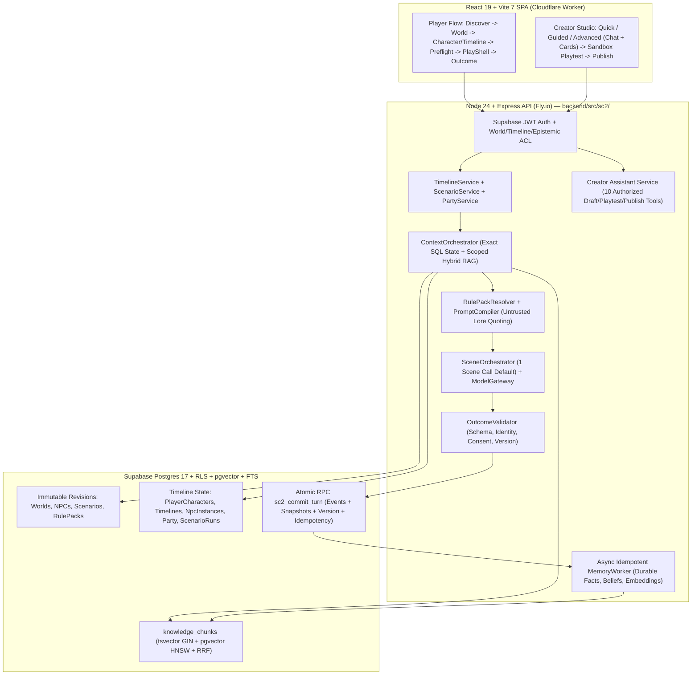

# StoneCaster 2.0 — Codebase Evaluation & High-Level Implementation Plan

**Branch:** `stonecaster-2.0` (standalone trunk — isolated from `main`)  
**Date:** 2026-10-31  
**Design Authority:** [`00_START_HERE.md`](file:///C:/Dev/Stone%20Caster/stone-caster-2/docs/Stonecaster_2_0/stonecaster2-design/00_START_HERE.md) – [`09_AGENT_HANDOFF.md`](file:///C:/Dev/Stone%20Caster/stone-caster-2/docs/Stonecaster_2_0/stonecaster2-design/09_AGENT_HANDOFF.md)

---

## 1. Executive Summary & Codebase Reality Check

Evaluating [`Daakon/stone-caster-2`](file:///C:/Dev/Stone%20Caster/stone-caster-2/package.json) against the [`stonecaster2-design`](file:///C:/Dev/Stone%20Caster/stone-caster-2/docs/Stonecaster_2_0/stonecaster2-design/README.md) specifications surfaced a foundational discrepancy alongside major reuse opportunities:

> [!IMPORTANT]
> **Design Pack Repo Mismatch:** [`07_PLATFORM_MIGRATION.md`](file:///C:/Dev/Stone%20Caster/stone-caster-2/docs/Stonecaster_2_0/stonecaster2-design/07_PLATFORM_MIGRATION.md#L37-L49) inspected an older repository (`Daakon/stonecaster` with `client/src`, `server/gameEngine.ts`, `server/bundleLoader.ts`, and Drizzle ORM). **This repository (`Daakon/stone-caster-2`) is already a newer monorepo** (`frontend/`, `backend/`, `shared/`, `supabase/`, `content/first-party/`) with **no Drizzle ORM installed** ([`drizzle.config.ts`](file:///C:/Dev/Stone%20Caster/stone-caster-2/drizzle.config.ts) is an orphaned leftover; all persistence uses `@supabase/supabase-js` + 19 SQL migrations + Postgres RPCs).

### 1.1 Five Architectural Generations Inside `stone-caster-2`

Rather than a single legacy engine, `stone-caster-2` currently carries **five overlapping generations** of code:

| Gen | Subsystem | Key Paths | Current Status |
|---|---|---|---|
| **Gen 0** | Orphaned prototype & archives | [`src/`](file:///C:/Dev/Stone%20Caster/stone-caster-2/src), [`_legacy_archive/`](file:///C:/Dev/Stone%20Caster/stone-caster-2/_legacy_archive), [`drizzle.config.ts`](file:///C:/Dev/Stone%20Caster/stone-caster-2/drizzle.config.ts) | **Dead.** Outside npm workspaces and `tsup` build. |
| **Gen 1** | Legacy AWF ("Adventure World Framework") | `backend/src/{dialogue,economy,crafting,inventory,graph,mechanics,party,sim,saves,goldens,playtest,assemblers}/`, [`games.service.ts`](file:///C:/Dev/Stone%20Caster/stone-caster-2/backend/src/services/games.service.ts), [`tools/author-cli/`](file:///C:/Dev/Stone%20Caster/stone-caster-2/tools/author-cli/package.json) | **Dead / Broken.** Queries omitted tables (`games`, `turns`, `stone_wallets`); causes live `GET /api/games` failure in [`active-game.controller.ts`](file:///C:/Dev/Stone%20Caster/stone-caster-2/backend/src/controllers/active-game.controller.ts#L20-L42). |
| **Gen 2** | Chimera V3 "Deterministic Cartridge" | [`game-v3.routes.ts`](file:///C:/Dev/Stone%20Caster/stone-caster-2/backend/src/routes/game-v3.routes.ts), [`NewGameWizard.tsx`](file:///C:/Dev/Stone%20Caster/stone-caster-2/frontend/src/features/game-v3/NewGameWizard.tsx), `chimera_instances_v3` | **Dormant / Broken.** Zero LLM calls; missing auth middleware causes constant `401`. |
| **Gen 3** | Chimera "Vital Spark" Runtime & Casting Circle | [`game-turn.service.ts`](file:///C:/Dev/Stone%20Caster/stone-caster-2/backend/src/services/game/game-turn.service.ts), [`director.service.ts`](file:///C:/Dev/Stone%20Caster/stone-caster-2/backend/src/services/runtime/director.service.ts), [`engine.service.ts`](file:///C:/Dev/Stone%20Caster/stone-caster-2/backend/src/services/runtime/engine.service.ts), [`mas2.service.ts`](file:///C:/Dev/Stone%20Caster/stone-caster-2/backend/src/services/runtime/mas2.service.ts), [`CastingCircleWizard.tsx`](file:///C:/Dev/Stone%20Caster/stone-caster-2/frontend/src/features/casting-circle/CastingCircleWizard.tsx) | **Live**, but directly contradicts StoneCaster 2.0 (see §1.2). |
| **Gen 4** | Sept–Oct 2026 F0a/F0b + Play-Redesign Phase 0 | [`PlayShell.tsx`](file:///C:/Dev/Stone%20Caster/stone-caster-2/frontend/src/features/play/components/PlayShell.tsx), [`tokens.css`](file:///C:/Dev/Stone%20Caster/stone-caster-2/docs/design/play-redesign/tokens.css), `backend/src/services/content/*`, [`entitlements.service.ts`](file:///C:/Dev/Stone%20Caster/stone-caster-2/backend/src/services/content/entitlements.service.ts), [`scripts/ci/*`](file:///C:/Dev/Stone%20Caster/stone-caster-2/scripts/ci/strict-policy.mjs) | **High-value UI, token, entitlement & CI foundation** (git-blob sync itself is superseded by DB revisions). |

### 1.2 Core Architectural Gaps Between Live Gen 3/4 and StoneCaster 2.0

1. **No World Timelines or Portable Parties (`save === single compiled story`):**
   - [`chimera_game_states`](file:///C:/Dev/Stone%20Caster/stone-caster-2/supabase/migrations/20260926000000_play_state_integrity.sql#L3-L36) pins each game session 1:1 to a single `compiled_story_id`.
   - [`GameInitService.initializeGame`](file:///C:/Dev/Stone%20Caster/stone-caster-2/backend/src/services/game/game-init.service.ts#L72-L90) copies `chimera_player_characters.state_snapshot` one-way at Turn 0 (and `world_id` was made nullable in [`20260925000000_content_snapshots.sql`](file:///C:/Dev/Stone%20Caster/stone-caster-2/supabase/migrations/20260925000000_content_snapshots.sql#L164)). NPCs exist only inside `mechanical_state.entities` JSONB per session. Leaving a story strands all character growth, companions, promises, and relationships inside that save row.
2. **Hardcoded Deterministic Mechanics & Multi-Call Turn Loop:**
   - Every routine turn in [`GameTurnService.processTurn`](file:///C:/Dev/Stone%20Caster/stone-caster-2/backend/src/services/game/game-turn.service.ts#L134-L555) runs **LLM Call #1 (`DirectorService`)** + optional **`JevShadowService`** + **deterministic D100/stamina/tier math (`EngineService`)** + **LLM Call #2 (`Mas2Service`)** + post-narration mutation clamping, with zero post-proposal `OutcomeValidator`.
3. **0% Active Runtime RAG or Scoped Memory:**
   - Postgres has `pgvector` and `chimera_lore.embedding`, but **nothing generates embeddings**, no `tsvector`/GIN full-text index exists, [`GameTurnService`](file:///C:/Dev/Stone%20Caster/stone-caster-2/backend/src/services/game/game-turn.service.ts#L157) passes `loreFragments = []`, and [`Mas2Service.extractLoreContext`](file:///C:/Dev/Stone%20Caster/stone-caster-2/backend/src/services/runtime/mas2.service.ts#L392-L401) only injects the count string `"There are N lore fragments available"` with zero lore text.
4. **Non-Atomic Turn Persistence & Unwired Idempotency:**
   - [`GameTurnService`](file:///C:/Dev/Stone%20Caster/stone-caster-2/backend/src/services/game/game-turn.service.ts#L501-L555) inserts into `chimera_turns` *before* optimistic-locking `chimera_game_states` across two separate HTTP calls (leaving orphan turn rows on `409`), and [`IdempotencyService`](file:///C:/Dev/Stone%20Caster/stone-caster-2/backend/src/services/idempotency.service.ts) is never called on turn endpoints.
5. **Manual Multi-Step Forms & Raw JSON Instead of Guided Creator Studio:**
   - Authoring splits across [`CastingCircleWizard.tsx`](file:///C:/Dev/Stone%20Caster/stone-caster-2/frontend/src/features/casting-circle/CastingCircleWizard.tsx) (6-stone Chimera bundle compiler), duplicate story editors, and `/admin/chimera/rulesets` raw JSON textareas, with zero AI Creator Assistant tools or disposable playtest sandboxes.

---

## 2. Recommended Path: "Clean-Room Parallel Core + Dead-Gen Pruning" on `stonecaster-2.0`

### 2.1 Path Evaluation

| Option | Strategy | Verdict |
|---|---|---|
| **Option A: In-Place Chimera Retrofit** | Mutate `chimera_game_states`, `GameTurnService`, `EngineService`, and `CastingCircleWizard` to add timelines and prompt rules. | **Reject.** Every Chimera RPC, JSONB blob, and form assumes 1:1 story saves and numeric `state_contributions`. Retrofitting creates a fragile "Gen 6" hybrid. |
| **Option B: Greenfield Rewrite** | Start an empty repository and rebuild auth, UI tokens, shell, CI, local stack, and deployment from scratch. | **Reject.** Discards months of working auth/RLS, `390px` literary design tokens, Phase 0 `PlayShell`, Cloudflare Images media, telemetry, local Docker Supabase, and strict CI gates. |
| **Option C: Clean-Room `sc2` Core + Early Dead-Code Pruning on Standalone Branch** | Keep the platform shell & `PlayShell` UI foundation, delete dead Gen 0/1/2 baggage early on `stonecaster-2.0`, build clean `sc2` (`backend/src/sc2/`, `shared/src/sc2/`, `/api/v2/*`) alongside frozen Gen 3/4 reference code, then retire Gen 3/4 once `sc2` passes MVP gates. | **Recommended.** Fastest, cleanest, lowest-risk path enabled specifically by our standalone branch isolation. |

### 2.2 Reuse vs. Adapt vs. Freeze/Retire Matrix

| Layer | Keep As-Is | Adapt for StoneCaster 2.0 | Prune Early (P0) or Retire at Cutover (P6) |
|---|---|---|---|
| **Platform & Auth** | Express bootstrap, [`auth.unified.ts`](file:///C:/Dev/Stone%20Caster/stone-caster-2/backend/src/middleware/auth.unified.ts), JWT/RLS Supabase client, Cloudflare Images (`chimera_assets`), [`llm-telemetry.ts`](file:///C:/Dev/Stone%20Caster/stone-caster-2/backend/src/services/runtime/llm-telemetry.ts) | [`earlyAccessGuard.ts`](file:///C:/Dev/Stone%20Caster/stone-caster-2/backend/src/middleware/earlyAccessGuard.ts) (cover `/api/v2/*`), [`entitlements.service.ts`](file:///C:/Dev/Stone%20Caster/stone-caster-2/backend/src/services/content/entitlements.service.ts) (shift quotas to Timelines, Runs & token/turn budgets) | **P0 Prune:** Root [`src/`](file:///C:/Dev/Stone%20Caster/stone-caster-2/src), [`_legacy_archive/`](file:///C:/Dev/Stone%20Caster/stone-caster-2/_legacy_archive), [`drizzle.config.ts`](file:///C:/Dev/Stone%20Caster/stone-caster-2/drizzle.config.ts), [`tools/author-cli/`](file:///C:/Dev/Stone%20Caster/stone-caster-2/tools/author-cli/package.json) |
| **Database & Persistence** | Supabase Auth, `user_profiles`, `ai_audit_logs`, SHA-256 canonical revision-hashing pattern | New normalized `sc2_*` tables + RLS + atomic `sc2_commit_turn` Postgres RPC + `tsvector` GIN & `pgvector` HNSW hybrid search (stay on SQL migrations + RPCs + Zod; no Drizzle rewrite needed) | **P0 Prune:** Dead Gen 1 AWF services querying missing tables (`games`, `stone_wallets`), broken `game-v3`. **P6 Retire:** `chimera_game_states`, `chimera_compiled_stories`, F0a/F0b git-sync tables |
| **AI & Story Runtime** | Synchronous "validate-and-commit before prose delivery" HTTP turn pattern | Evolve [`openai-compatible.ts`](file:///C:/Dev/Stone%20Caster/stone-caster-2/backend/src/services/runtime/openai-compatible.ts) into `ModelGateway` (OpenAI, Anthropic, Google, OpenRouter + Mock); build `ContextOrchestrator`, `RulePackResolver`, `PromptCompiler`, single-call `SceneOrchestrator`, `OutcomeValidator`, `MemoryWorker` | **P6 Retire:** `DirectorService`, `EngineService` (`d100-resolution.ts`, `rule-steps.ts`), `Mas2Service`, `JevShadowService` |
| **Frontend UX** | [`tokens.css`](file:///C:/Dev/Stone%20Caster/stone-caster-2/docs/design/play-redesign/tokens.css), `shadcn/ui` primitives, [`PlayShell.tsx`](file:///C:/Dev/Stone%20Caster/stone-caster-2/frontend/src/features/play/components/PlayShell.tsx), `ThreeColumnLayout`, `PlayComposer`, `CatalogGrid`, Playwright + `axe` harness | Invert player flow (`Discover → World → Character/Timeline → Party & Scenario Preflight → Story → Outcome/Journal`); upgrade `PlayTranscript` for actor-attributed dialogue/threads; build 4-entry **Creator Studio** + **Sandbox Playtest** | **P0 Prune:** Duplicate legacy gateways (`NewGameWizard`, `PlayerGatewayPage`, `CharacterCreationPage`, `CreateStoryPage`). **P6 Retire:** `CastingCircleWizard`, `/admin/chimera/*` raw JSON editors |

### 2.3 Target StoneCaster 2.0 Architecture

---

## 3. Standalone Branch, Infrastructure, CI/CD & Deployment Plan

Because `stonecaster-2.0` must remain **100% standalone and never merge into or deploy over `main`** until explicitly approved for cutover, Phase 0 establishes hard technical fences before feature work begins.

> [!CAUTION]
> **Live Production Hazards Discovered in Current Repo:**
> 1. Running `npm run dev` executes [`dev-with-default-env.js`](file:///C:/Dev/Stone%20Caster/stone-caster-2/backend/scripts/dev-with-default-env.js), which loads untracked `backend/.env` pointing directly at the **live v1 Supabase database** (`obfadjnywufemhhhcxiy`).
> 2. [`deploy.ps1`](file:///C:/Dev/Stone%20Caster/stone-caster-2/deploy.ps1), [`deploy-backend.ps1`](file:///C:/Dev/Stone%20Caster/stone-caster-2/deploy-backend.ps1), [`deploy-client.ps1`](file:///C:/Dev/Stone%20Caster/stone-caster-2/deploy-client.ps1), and `npm run deploy` deploy straight to production `stonecaster-api` (Fly.io) and `stone-caster` (`stonecaster.ai` Cloudflare Worker) with **zero branch check**.
> 3. [`.mcp.json`](file:///C:/Dev/Stone%20Caster/stone-caster-2/.mcp.json) and [`.codex/config.toml`](file:///C:/Dev/Stone%20Caster/stone-caster-2/.codex/config.toml) enable hosted Supabase MCP write/DDL features (`apply_migration`, `execute_sql`, `merge_branch`) while agent rules falsely claim MCP is read-only.

### 3.1 Git Branch & Environment Isolation Blueprint

1. **Standalone Trunk (`stonecaster-2.0`):**
   - `stonecaster-2.0` serves as the long-lived integration trunk. Short-lived phase/feature branches (`sc2/p0-*`, `sc2/p1-*`) branch from `stonecaster-2.0` and merge **only** into `stonecaster-2.0` (`--base stonecaster-2.0`, never `main`, auto-merge to `main` strictly prohibited).
   - Once pushed to GitHub, protect `stonecaster-2.0` with required CI status checks.
2. **Database Isolation (Local Docker + Dedicated V2 Staging Project):**
   - **Local Dev:** Rewire `npm run dev` on `stonecaster-2.0` to [`stonecaster-local.mjs`](file:///C:/Dev/Stone%20Caster/stone-caster-2/scripts/stonecaster-local.mjs) (`127.0.0.1:54421`/`:54422` via `.env.stonecaster-local`) and set `project_id = "stonecaster-v2"` in [`supabase/config.toml`](file:///C:/Dev/Stone%20Caster/stone-caster-2/supabase/config.toml) so Docker volumes never collide with `main`.
   - **Runtime Ref Fence:** Add a fail-closed startup guard in backend config and migration/seed scripts that **aborts immediately if `SUPABASE_URL` or `DATABASE_URL` contains the v1 production project ref (`obfadjnywufemhhhcxiy`)**.
   - **Hosted Staging:** Use a **separate standalone Supabase project** (`stonecaster-v2-staging`) rather than a Supabase Preview Branch of v1 production, guaranteeing 100% physical separation of schema, Auth, RLS, and storage.
3. **Deployment Pipeline & Hosting Isolation:**
   - **Block V1 Prod Scripts:** Replace/guard `deploy*.ps1`, `set-fly-*.ps1`, `fix-*.ps1`, and `backend/package.json` `"deploy"` on `stonecaster-2.0` so they fail closed unless explicitly targeting `v2-staging`. Remove stale duplicate `backend/fly.toml`.
   - **Isolated V2 Staging Targets:**
     - **Fly.io:** Add `fly.v2-staging.toml` targeting `app = "stonecaster-api-v2-staging"`. Upgrade [`Dockerfile`](file:///C:/Dev/Stone%20Caster/stone-caster-2/Dockerfile) from `node:20-alpine` to `node:24-alpine` to match CI.
     - **Cloudflare Workers:** Add `[env.v2_staging]` in [`wrangler.toml`](file:///C:/Dev/Stone%20Caster/stone-caster-2/wrangler.toml) (`name = "stone-caster-v2-staging"`, `workers_dev = true`, no `stonecaster.ai` routes, `API_BASE_URL` pointing to `stonecaster-api-v2-staging`).
4. **Secret & `.gitignore` Hardening:**
   - Update root/frontend/backend [`.gitignore`](file:///C:/Dev/Stone%20Caster/stone-caster-2/.gitignore) to ignore `.env.*` (allowing `!.env.example` and `!.env.stonecaster-local`), `.claude/*.local.json`, and `/tmp/`.
   - Consolidate drifted `.env.example` files and lock down [`.mcp.json`](file:///C:/Dev/Stone%20Caster/stone-caster-2/.mcp.json) / [`.codex/config.toml`](file:///C:/Dev/Stone%20Caster/stone-caster-2/.codex/config.toml) to `features=docs` (or `read_only=true` scoped strictly to `stonecaster-v2-staging`).

### 3.2 CI/CD & Quality Gate Changes

| CI Component | Current Issue on `stonecaster-2.0` | Planned Change |
|---|---|---|
| [`.github/workflows/ci.yml`](file:///C:/Dev/Stone%20Caster/stone-caster-2/.github/workflows/ci.yml) & [`api-docs.yml`](file:///C:/Dev/Stone%20Caster/stone-caster-2/.github/workflows/api-docs.yml) | Trigger only on `[main, develop]`; `lint` job in `ci.yml` L46 is disabled (`if: false`)! | Add `stonecaster-2.0` to `push` and `pull_request` branches; **re-enable the `lint` gate**; keep `deploy-content.yml` locked to `main`. |
| [`check-anti-gaming.mjs`](file:///C:/Dev/Stone%20Caster/stone-caster-2/scripts/ci/check-anti-gaming.mjs#L8-L13) & [`check-format.mjs`](file:///C:/Dev/Stone%20Caster/stone-caster-2/scripts/ci/check-format.mjs) | Hardcodes git diff base to `origin/main` and fails local `ci:all` / `push` runs whenever any legacy `*.test.*` file is retired without a PR body `TEST-REMOVAL:` tag. | Resolve diff base dynamically (`STONECASTER_BASE_REF` / `GITHUB_BASE_REF` / `origin/stonecaster-2.0`) and support a committed `scripts/ci/approved-v1-retirements.json` manifest. |
| [`strict-policy.mjs`](file:///C:/Dev/Stone%20Caster/stone-caster-2/scripts/ci/strict-policy.mjs), [`check-strict-coverage.mjs`](file:///C:/Dev/Stone%20Caster/stone-caster-2/scripts/ci/check-strict-coverage.mjs), [`eslint.config.js`](file:///C:/Dev/Stone%20Caster/stone-caster-2/eslint.config.js), [`.dependency-cruiser.js`](file:///C:/Dev/Stone%20Caster/stone-caster-2/.dependency-cruiser.js), [`knip.jsonc`](file:///C:/Dev/Stone%20Caster/stone-caster-2/knip.jsonc) | Hardcodes `chimera-play-view.ts` and v1 paths; `isNew(path)` puts 100% of new 2.0 files under zero-tolerance strict TS, ESLint, Knip, tokens, and >=80% line/branch coverage. | Keep the zero-tolerance Strict Zone for all `sc2` code (write tests alongside every new module so `--coverage.all` stays >=80%); register `backend/src/sc2/{routes,services,repos}` layer rules in Dependency Cruiser and entrypoints in `knip.jsonc`. |
| **New AI Evaluation Gate** | No automated epistemic, continuity, or prompt-injection eval harness exists. | Add deterministic Vitest epistemic/idempotency suite to `ci:all` + a `ci:evals` **Promptfoo** runner against the 50-case corpus in [`08_MVP_EVALUATION.md`](file:///C:/Dev/Stone%20Caster/stone-caster-2/docs/Stonecaster_2_0/stonecaster2-design/08_MVP_EVALUATION.md#L56-L67) for model/rule-pack changes. |

---

## 4. AI Instructions, Rules & Skills Overhaul

Our audit of `.agent/`, `.cursor/`, `.claude/`, `.codex/`, and root agent docs revealed broken instructions that will actively sabotage coding agents if left unfixed (including UTF-16LE corrupted rule files, PowerShell-mangled markdown, `pnpm` mandates in an `npm` repo, Chimera MAS-1/Engine/MAS-2 mandates, and auto-merge-to-`main` rules).

### 4.1 Canonical Instructions & Rules Cleanup

1. **Rewrite [`AGENTS.md`](file:///C:/Dev/Stone%20Caster/stone-caster-2/AGENTS.md) as the Single Canonical Entrypoint:**
   - Establish [`docs/Stonecaster_2_0/stonecaster2-design/00_START_HERE.md`](file:///C:/Dev/Stone%20Caster/stone-caster-2/docs/Stonecaster_2_0/stonecaster2-design/00_START_HERE.md) as architectural authority; mark root Chimera/Deterministic Engine docs (`docs/01_*`–`07_*`, `docs/Deterministic Engine/*`) with clear superseded banners.
   - Mandate `stonecaster-2.0` standalone branch workflow (forbid touching or opening PRs against `main`), `npm` workspace scripts, `npm run local:*` local stack usage, `390×844` mobile-first design tokens, and `npm run ci:all`.
   - Convert [`CLAUDE.md`](file:///C:/Dev/Stone%20Caster/stone-caster-2/CLAUDE.md) and [`.github/copilot-instructions.md`](file:///C:/Dev/Stone%20Caster/stone-caster-2/.github/copilot-instructions.md) into thin, accurate pointers to `AGENTS.md` + `docs/Stonecaster_2_0/AI_AGENT_CONTEXT.md`.
2. **Repair & Update [`.cursor/rules/*.mdc`](file:///C:/Dev/Stone%20Caster/stone-caster-2/.cursor/rules) (14 files) and [`.agent/rules/*.md`](file:///C:/Dev/Stone%20Caster/stone-caster-2/.agent/rules) (29 files):**
   - Rewrite [`97-mainline-integration.mdc`](file:///C:/Dev/Stone%20Caster/stone-caster-2/.cursor/rules/97-mainline-integration.mdc) to branch from and integrate into `stonecaster-2.0` (hard ban merging to `main`).
   - Fix `pnpm` → `npm` in `94-package-scripts-only.mdc` and `92-headless-and-single-run.mdc`; re-encode UTF-16LE `95-atomic-commits.mdc` to UTF-8 and fix bottom-placed YAML frontmatter in `95`/`96`.
   - Replace [`05-chimera-architecture.mdc`](file:///C:/Dev/Stone%20Caster/stone-caster-2/.cursor/rules/05-chimera-architecture.mdc) and [`rule-runtime-state-tiers.md`](file:///C:/Dev/Stone%20Caster/stone-caster-2/.agent/rules/rule-runtime-state-tiers.md) with StoneCaster 2.0 domain, prompt-driven Rule Pack, and server-authoritative event rules.
   - Fix PowerShell-corrupted files (`rule-frontend-data-layer.md`, `rule-service-error-taxonomy.md`, `rule-no-db-in-routes.md`, `rule-no-logic-in-routes.md`), update `client/server` globs to `frontend/backend`, standardize `390×844` viewport and `{ success, data/error }` API envelopes, and consolidate redundant `always_on` rules down to ~10 concise files (using `model_decision` triggers for domain-specific rules to preserve context budget).
3. **Workspace Root Discovery Alignment:**
   - Because `.git` lives in `c:\Dev\Stone Caster\stone-caster-2` (one level below `c:\Dev\Stone Caster`), recommend opening `c:\Dev\Stone Caster\stone-caster-2` directly as the IDE workspace root—and place a lightweight root `AGENTS.md` pointer in `c:\Dev\Stone Caster` if the parent folder continues to be used.

### 4.2 Migrate Legacy `.agent/workflows/*.md` to Modern Cross-Agent Skills (`.agents/skills/`)

Archive deprecated `.agent/workflows/*.md` (retiring unsafe `workflow-backend-deployment.md` and stale `workflow-ux-flow-adherence.md`) and author **six progressive-disclosure `SKILL.md` skills** under `.agents/skills/` (usable across Antigravity, Claude Code, Cursor, and Codex):

| Skill (`/.agents/skills/<name>/SKILL.md`) | Purpose |
|---|---|
| `sc2-branch-and-gates` | Safe task branching off `stonecaster-2.0`, running `npm run ci:all`, strict-zone >=80% coverage rules, and retirement manifest workflow. |
| `sc2-local-stack` | Managing isolated local Docker Supabase (`npm run local:up/reset/dev/smoke`), seeding 2.0 test worlds, and avoiding `backend/.env` prod leaks. |
| `sc2-db-migrations-and-rls` | Writing additive SQL migrations, `sc2_commit_turn` transactional RPCs, `pgvector` + `tsvector` hybrid indexes, RLS policies, and tenancy tests without touching hosted MCP. |
| `sc2-context-and-rule-packs` | Authoring/compiling versioned Rule Packs, enforcing epistemic scopes (`world_fact` vs `character_belief` vs `creator_secret`), untrusted lore quoting, and running Promptfoo/Vitest evals. |
| `sc2-ui-and-a11y` | Building mobile-first (`390×844` → `1100` → `1440`) screens with `tokens.css`, `PlayShell`, mocked Playwright screenshots, and zero-critical `axe` checks. |
| `sc2-staging-deploy` | Guarded runbook for deploying exclusively to `stonecaster-v2-staging` (Supabase + Fly.io + Cloudflare Worker preview) with preflight ref verification. |

---

## 5. High-Level Phased Roadmap (P0 → P6)

Each phase delivers a testable vertical slice with objective exit gates before the next phase starts. Detailed task-by-task breakdowns will be produced per phase after this master plan is approved.

```mermaid
flowchart LR
    P0["P0: Branch Lock, CI/Deploy Fences, AI Skills & Dead-Gen Prune"] --> P1["P1: Domain Contracts, SQL/RLS & Headless A->B Party Continuity"]
    P1 --> P2["P2: ModelGateway, 1-Call Scene Runtime & Player Vertical Slice UX"]
    P2 --> P3["P3: Scoped Hybrid RAG, Epistemic Memory & Prompt Rule Packs"]
    P3 --> P4["P4: AI-Guided Creator Studio, Playtest Sandbox & Publishing"]
    P4 --> P5["P5: 50-Case Eval Corpus, Cost Quotas & V2 Staging Launch"]
    P5 --> P6["P6: Gen 3/4 Chimera Retirement, Content Import & Cutover Ready"]
```

### Phase P0 — Safety Fences, CI/Deploy Isolation, AI Governance & Dead-Code Prune
- **Scope:** Lock down `.gitignore`, `.mcp.json`, production deploy scripts, and backend v1 Supabase ref fence; rewire `npm run dev` to local stack; update `ci.yml` (add `stonecaster-2.0`, re-enable `lint`), `check-anti-gaming.mjs`, Dependency Cruiser, and Knip; rewrite `AGENTS.md`, `.cursor/rules`, `.agent/rules`, and create `.agents/skills/*`; add superseded notices to conflicting Chimera/AWF docs; delete pure-dead Gen 0/1/2 code (`src/`, `_legacy_archive/`, `drizzle.config.ts`, `tools/author-cli/`, unreferenced AWF folders, broken `game-v3`, duplicate legacy UI gateways).
- **Exit Gate:** `npm run ci:all` is 100% green locally and on GitHub Actions for `stonecaster-2.0`; impossible for local dev, scripts, or agents to mutate `main` or v1 production (`obfadjnywufemhhhcxiy` / `stonecaster-api` / `stonecaster.ai`).

### Phase P1 — Core 2.0 Contracts, Persistence & Headless Scenario A → B Proof
- **Scope:** Author `shared/src/sc2/` Zod contracts; add Supabase SQL migrations + RLS + atomic `sc2_commit_turn` RPC for `worlds` (+ revisions), `npc_definitions` (+ revisions), `scenario_definitions` (+ revisions), `rule_packs` (+ revisions), `player_characters` (world-bound `NOT NULL`), `timelines`, `npc_instances`, `party_memberships`, `scenario_runs`, `timeline_events` (idempotent + optimistic version), and `relationships`; build `TimelineService`, `ScenarioService`, `PartyService`, and `/api/v2/*` state endpoints; seed the `Emberlight Academy` fixture (`Rowan`, `Lyra`, `Tessa`, `Provost Merin`, `Scenario A`, `Scenario B`).
- **Exit Gate:** Automated integration tests pass **`ID-01`, `TL-01`, `NPC-01`, `NPC-03`, `SC-01`, `SC-02`, `SC-03`, `RT-01`** (recruit `Lyra` in Scenario A, complete/abandon A, carry identical `NpcInstance` + history into Scenario B, zero leakage into Timeline 2) without requiring live LLM calls.

### Phase P2 — `ModelGateway`, Single-Call Story Runtime & Player Vertical Slice UX
- **Scope:** Build provider-neutral `ModelGateway` (OpenAI, Anthropic, Google, OpenRouter + deterministic Mock, capability registry, cost/token telemetry into `ai_audit_logs`); implement `SceneOrchestrator` (1 call per routine turn) + `OutcomeValidator` (schema, actor identity/consent, world bounds, 1 bounded repair max, zero synthetic fallback prose); build mobile-first Player UX (`Discover` → `World` → `Character/Timeline` → `Party & Scenario Preflight` → adapted `PlayShell` with actor-attributed dialogue, story threads, and in-world relationship journal → `Scenario Outcome/Leave Summary`).
- **Exit Gate:** Interactive browser E2E playthrough from Scenario A into Scenario B passes **`NPC-02`, `RT-02`, `MOD-01`, `UX-01`** across at least two model profiles and mocked Playwright tests at `390px`, `1100px`, and `1440px`.

### Phase P3 — Context Intelligence, Scoped Hybrid RAG, Memory Worker & Rule Packs
- **Scope:** Add `knowledge_chunks` (`tsvector` GIN + `pgvector` HNSW + Reciprocal Rank Fusion) with pre-retrieval epistemic authorization (`world_fact`, `timeline_fact`, `character_known_fact`, `character_belief`, `player_known_fact`, `creator_secret`) and untrusted-content prompt-injection framing; implement post-commit idempotent `MemoryWorker` + transcript compaction; build `RulePackResolver` + `PromptCompiler` with the 4 initial packs (`NPC Agency`, `Relationships`, `Abilities`, `Tactical Conflict — Detailed`) and authorized *"Why did this NPC say that?"* debug inspector.
- **Exit Gate:** Deterministic and model-backed evaluations pass **`KNOW-01`, `KNOW-02`, `RAG-01`, `RULE-01`, `RULE-02`** (Lyra recalls Scenario A promise in Scenario B without full transcript; private secrets never leak; Provost Merin's false belief stays distinct from canon truth; tactical rule pack adjudicates combat without coded RPG math).

### Phase P4 — AI-Guided Creator Studio, Playtest Sandbox & Publishing
- **Scope:** Promote authoring out of `/admin/*` into 4 independent Creator Studio flows (`World`, `NPC`, `Scenario`, `Rule Pack`) with `Quick Create`, `Guided`, and `Advanced` (Chat + Editable Cards + World Connections browser + MD/TXT/PDF seed upload); implement the 10 ACL-checked Creator Assistant tools (`draft_*`, `search_world_content`, `validate_draft`, `preview_context`, `run_playtest`, `suggest_revision`, `publish_revision`); build disposable **Sandbox Playtest** (`PlayShell` + `Reset` + context/rule inspector) and **Publish Wizard** (plain-language quality rubric, `owner-only` / `approval-required` / `open-community` world permissions, immutable `published_revision`s).
- **Exit Gate:** Non-expert creator flow passes **`CR-01` and `CR-02`**—authoring, playtesting, refining via natural-language critique, and publishing a standalone NPC and Scenario with zero raw JSON or prompt syntax.

### Phase P5 — Evaluation Corpus, Cost Guardrails & Isolated V2 Staging Launch
- **Scope:** Complete the 50+ case reproducible evaluation dataset in Promptfoo + Vitest (autonomy, epistemics, cross-scenario continuity, rule activation, prompt injection, adversarial output) across Standard, Premium, and Experimental profiles; adapt `EntitlementsService` for per-user/profile turn & token cost budgets + model-switch checkpoints; provision and deploy `stonecaster-v2-staging` (`stonecaster-v2-staging` Supabase + `stonecaster-api-v2-staging` Fly.io + `stone-caster-v2-staging` Cloudflare Worker); full WCAG AA / `axe` & latency/cost telemetry sign-off.
- **Exit Gate:** 100% pass on deterministic isolation/epistemic/schema gates, >=90% target on seeded narrative/agency evals, accurate per-turn cost ledger, and live private testing running cleanly on `stonecaster-v2-staging`.

### Phase P6 — Legacy Chimera Retirement, Curated Content Import & Cutover Readiness
- **Scope:** Remove remaining frozen Gen 3/4 Chimera runtime, compiler, git-blob sync, and `CastingCircleWizard` code on `stonecaster-2.0`; provide a clean one-way import script to convert curated first-party worlds/NPCs/lore (e.g., Mystika) into 2.0 definitions; finalize production cutover/migration runbook once `stonecaster-2.0` is approved to succeed `main`.
- **Exit Gate:** Single cohesive 2.0 codebase with zero legacy runtime duplication, ready for beta/cutover decision.

---

## 6. Key Decisions to Confirm Before Breaking Down Phase P0

1. **Database Layer — Stay on Supabase SQL Migrations + RPCs + Zod (Recommended) vs. Introduce Drizzle ORM:**
   - Despite [`07_PLATFORM_MIGRATION.md`](file:///C:/Dev/Stone%20Caster/stone-caster-2/docs/Stonecaster_2_0/stonecaster2-design/07_PLATFORM_MIGRATION.md) mentioning Drizzle, `stone-caster-2` has zero Drizzle dependencies and uses Supabase SQL migrations + Postgres RPCs + `@supabase/supabase-js` + Zod. Staying on SQL migrations + transactional RPCs + typed repositories avoids introducing a second DB layer. Confirm we should stick with **Supabase SQL + RPCs + Zod**?
2. **AI SDK Choice in `ModelGateway`:**
   - Use **Vercel AI SDK (`ai` + `@ai-sdk/{openai,anthropic,google}` + OpenRouter provider)** for unified structured outputs, prompt caching, and token telemetry, OR keep thin native `fetch`/provider SDK adapters extending [`openai-compatible.ts`](file:///C:/Dev/Stone%20Caster/stone-caster-2/backend/src/services/runtime/openai-compatible.ts)? *(Recommendation: Vercel AI SDK `ai` core inside `ModelGateway`, wrapped behind our own `ModelGateway` interface so business logic never depends on vendor SDK types.)*
3. **Hosted V2 Staging Provisioning Timing:**
   - Develop **100% against the isolated local Docker Supabase stack** (`stonecaster-local.mjs`) during **P0–P3** and spin up hosted `stonecaster-v2-staging` (new Supabase project + Fly app + Cloudflare Worker env) at **P4/P5**, OR set up hosted `stonecaster-v2-staging` immediately in **P0**?
4. **Gen 3/4 Chimera Code Disposition on `stonecaster-2.0`:**
   - Because `main` already preserves the untouched live v1/Chimera app, on `stonecaster-2.0` we recommend **deleting pure-dead Gen 0/1/2 code in P0**, keeping Gen 3/4 Chimera read-only for reference while adapting `PlayShell` in P1–P4, and **removing Gen 3/4 in P6**. Confirm you want that clean progression (rather than keeping legacy Chimera playable forever inside 2.0)?
