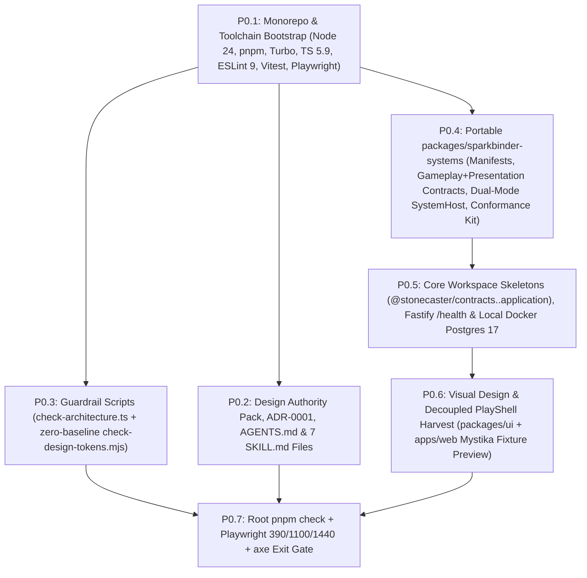

# StoneCaster 2.0 — Concrete Work-Item Breakdown (`P0` Deep Spec + `P1`–`P5` Backlog)

**Parent Plan:** [`STONECASTER_2_IMPLEMENTATION_PLAN.md`](file:///C:/Dev/Stone%20Caster/stone-caster-2/docs/Stonecaster_2_0/STONECASTER_2_IMPLEMENTATION_PLAN.md) (v3 — Approved)  
**Target Clean-Slate Repo:** `C:\Dev\StoneCaster-2`  
**Donor / Ecosystem Repos:**
- `C:\Dev\Stone Caster\stone-caster-2` (read-only donor archive; `main` untouched at `0ba046db`, planning docs on standalone `stonecaster-2.0`)
- `C:\Dev\SparkBinder` (canonical Modular Gameplay Systems Standard owner & toolchain donor)
- `C:\Dev\RPG Systems\mystika-rpg-systems` (system boundary specs, Mystika validation scenarios, & `modular-standard-proof` reference packages)

---

## 1. Phase P0 Execution Graph (`C:\Dev\StoneCaster-2`)

---

## 2. Phase P0 — Concrete Task-by-Task Specification

### P0.1 — Clean-Slate Monorepo & Toolchain Bootstrap
- **Objective:** Initialize `C:\Dev\StoneCaster-2` with an isolated git history (`main`), matching [`SparkBinder/package.json`](file:///C:/Dev/SparkBinder/package.json)'s modern toolchain and zero legacy debt.
- **Files to Create in `C:\Dev\StoneCaster-2`:**
  - `.node-version` (`24.20.0`), `pnpm-workspace.yaml` (`apps/*`, `packages/*`), `turbo.json` (`build`, `typecheck`, `lint`, `test` pipelines).
  - `package.json` (`packageManager: "pnpm@11.25.0"`, `turbo@2.5.6`, `typescript@5.9.2`, `eslint@9.34.0`, `eslint-plugin-jsx-a11y`, `prettier`, `vitest@3.2.4`, `@playwright/test@1.63.0`, `@axe-core/playwright`, `tsx`).
  - `tsconfig.base.json` (`target: "ES2023"`, `module: "NodeNext"`, `strict: true`, `noUncheckedIndexedAccess: true`, `exactOptionalPropertyTypes: true`, `isolatedModules: true`).
  - `eslint.config.mjs` (flat ESLint 9 config with zero legacy ignore lists) + `.prettierrc.json`.
  - `.gitignore` (blocks `.env*` except `.env.example` and `.env.local-demo`, `.claude/*.local.json`, `/tmp/`, `playwright-report/`, `test-results/`, `dist/`).
  - `.env.example` & `.env.local-demo` (local Docker Postgres port `54329`, `SC2_DEFAULT_MODEL_PROVIDER=mock`, zero cloud secrets).
  - `.mcp.json` (read-only/docs posture; no hosted Supabase write access).
  - `.github/workflows/ci.yml` (runs `pnpm check` + `pnpm test:e2e` on Node `24.20.x`) and `.github/workflows/evals.yml` (stubbed manual/path-filtered `Promptfoo` + conformance workflow).
- **Acceptance Check:** `git status` on `C:\Dev\StoneCaster-2` shows branch `main`; `pnpm install` succeeds cleanly with zero peer warnings or deprecated v1 packages.

---

### P0.2 — Design Authority Pack, `ADR-0001`, AI Governance & 7 `SKILL.md` Files
- **Objective:** Establish self-contained design authority and progressive-disclosure AI instructions inside `C:\Dev\StoneCaster-2` (`D11`).
- **Files to Copy / Create in `C:\Dev\StoneCaster-2`:**
  - `docs/design/` — copy [`stonecaster2-design/00_START_HERE.md`](file:///C:/Dev/Stone%20Caster/stone-caster-2/docs/Stonecaster_2_0/stonecaster2-design/00_START_HERE.md)–[`09_AGENT_HANDOFF.md`](file:///C:/Dev/Stone%20Caster/stone-caster-2/docs/Stonecaster_2_0/stonecaster2-design/09_AGENT_HANDOFF.md), [`STONECASTER_2_MASTER_DESIGN.md`](file:///C:/Dev/Stone%20Caster/stone-caster-2/docs/Stonecaster_2_0/STONECASTER_2_MASTER_DESIGN.md), [`STONECASTER_2_IMPLEMENTATION_PLAN.md`](file:///C:/Dev/Stone%20Caster/stone-caster-2/docs/Stonecaster_2_0/STONECASTER_2_IMPLEMENTATION_PLAN.md), and this breakdown.
  - `docs/architecture/ADR/ADR-0001-ecosystem-and-clean-slate-architecture.md` — codifies `D1`–`D12` (three-repo split, `SparkBinder` canonical ownership of `packages/sparkbinder-systems`, unified Gameplay + Presentation Systems, Dual-Mode `SystemHost`, Two-Knower epistemics, v1 Supabase deny-list).
  - `AGENTS.md` — concise universal entrypoint (`<200` lines): authority order, package dependency table, mobile-first `390×844` & token rules, local stack commands, and `pnpm check` gate.
  - Thin agent pointers: `CLAUDE.md`, `GEMINI.md`, `.cursor/rules/00-stonecaster2.mdc` (UTF-8 LF, pointing to `AGENTS.md` and `skills/`).
  - `docs/PROJECT_STATE.md` — live phase/task tracker (`P0` active, `P1`–`P5` queued).
  - Canonical `<500`-line skills in `skills/<name>/SKILL.md` (mirrored to `.agents/skills/<name>/SKILL.md`):
    1. `sc2-architecture-and-boundaries`
    2. `sc2-sparkbinder-systems`
    3. `sc2-persistence-and-epistemics`
    4. `sc2-context-rag-and-evals`
    5. `sc2-mobile-play-and-studio-ux`
    6. `sc2-local-stack-and-testing`
    7. `sc2-cloud-deploy-and-ops`
- **Acceptance Check:** Every `SKILL.md` has valid YAML frontmatter (`name`, `description`), is `<500` lines, and passes UTF-8 LF encoding check.

---

### P0.3 — Inward Architecture & Design-Token Guardrail Scripts (`scripts/`)
- **Objective:** Enforce inward package boundaries, `sparkbinder-systems` portability (`D2`), and zero hardcoded UI colours (`D12`) automatically in `pnpm check`.
- **Donor Sources:** [`SparkBinder/scripts/check-architecture.ts`](file:///C:/Dev/SparkBinder/scripts/check-architecture.ts) and [`stone-caster-2/scripts/check-design-tokens.mjs`](file:///C:/Dev/Stone%20Caster/stone-caster-2/scripts/check-design-tokens.mjs).
- **Files to Create in `C:\Dev\StoneCaster-2`:**
  - `scripts/check-architecture.ts`:
    - Enforces exact workspace package graph:
      - `@sparkbinder/systems` (`packages/sparkbinder-systems`) → **`∅` (zero workspace dependencies; zero `@stonecaster/*`, `fastify`, `pg`, `kysely`, `react`, or `ai` SDK imports; game-neutral terminology check)**.
      - `@stonecaster/contracts` (`packages/contracts`) → `[@sparkbinder/systems]`.
      - `@stonecaster/model-gateway` (`packages/model-gateway`) → `[@stonecaster/contracts]`.
      - `@stonecaster/persistence` (`packages/persistence`) → `[@sparkbinder/systems, @stonecaster/contracts]`.
      - `@stonecaster/application` (`packages/application`) → `[@sparkbinder/systems, @stonecaster/contracts, @stonecaster/model-gateway, @stonecaster/persistence]`.
      - `@stonecaster/ui` (`packages/ui`) → `[@stonecaster/contracts]`.
      - `@stonecaster/api` (`packages/api` / `apps/api`) → `[@stonecaster/application, @stonecaster/contracts]`.
      - `@stonecaster/web` (`apps/web`) → `[@stonecaster/contracts, @stonecaster/ui]`.
    - Includes intentional negative self-test fixtures under `scripts/fixtures/` (`forbidden-sparkbinder-stonecaster-import.ts`, `forbidden-sparkbinder-infra-import.ts`, `forbidden-web-persistence-import.ts`) asserting the scanner catches boundary breaches before passing.
  - `scripts/check-design-tokens.mjs`:
    - Scans `packages/ui/src` and `apps/web/src` with **no baseline file (`allowed = 0`)**. Fails immediately on any hardcoded hex, `rgb()`, `hsl()`, or raw Tailwind palette utility outside `packages/ui/src/styles/tokens.css`.
- **Acceptance Check:** `pnpm architecture:check` (including negative fixture self-tests) and `pnpm design:check` both pass in `<2s`.

---

### P0.4 — Portable `packages/sparkbinder-systems` (`@sparkbinder/systems`)
- **Objective:** Build the portable, zero-StoneCaster-dependency Modular Gameplay & Presentation Systems package (`D2`, `D3`, `D4`) ready for lift-and-move canonical ownership in `SparkBinder`.
- **Donor Sources:**
  - [`package-v1.schema.json`](file:///C:/Dev/RPG%20Systems/mystika-rpg-systems/reference/modular-standard-proof/schemas/package-v1.schema.json)
  - [`modular-standard-proof/packages/contracts/src/index.ts`](file:///C:/Dev/RPG%20Systems/mystika-rpg-systems/reference/modular-standard-proof/packages/contracts/src/index.ts)
  - [`modular-standard-proof/packages/ability-coordinator/src/index.ts`](file:///C:/Dev/RPG%20Systems/mystika-rpg-systems/reference/modular-standard-proof/packages/ability-coordinator/src/index.ts)
  - [`modular-standard-proof/packages/conformance/src/index.ts`](file:///C:/Dev/RPG%20Systems/mystika-rpg-systems/reference/modular-standard-proof/packages/conformance/src/index.ts)
  - [`SparkBinder ADR-0024`](file:///C:/Dev/SparkBinder/docs/architecture/ADR/ADR-0024-modular-gameplay-system-model.md) & [`modular-gameplay-systems-standard.md`](file:///C:/Dev/RPG%20Systems/mystika-rpg-systems/docs/modular-gameplay-systems-standard.md) (§5–§17)
- **Files to Create under `packages/sparkbinder-systems/`:**
  - `schemas/package-v1.schema.json` + `src/manifest/manifest-schema.ts`:
    - Validates `modular-gameplay/package@1` manifests (`id`, `version`, `name`, `kind`, `systemFamily: "gameplay" | "presentation"`, `conformance` tier, and the 10 explicit connection port kinds).
  - `src/contracts/ports-and-state.ts`:
    - Typed `Result<T>` / `ContractFailure`, `CapabilityId` (`namespace.domain:name@major`), `StateSliceDescriptor` (single-owner capability-partitioned state rule), `CommittedEvent`, and `TraceEntry`.
  - `src/contracts/system-definitions.ts`:
    - **5-Layer `GameplaySystemPackage`** (`spec`, `connections`, `rules`, `testSuites`, optional `CapabilityProvider` runtime + optional `PromptAdjudicationProfile` for qualitative/unresolved rules).
    - **5-Layer `PresentationSystemPackage`** (Modular Standard §17: enforces **zero owned gameplay state slices** and **zero gameplay mutation permissions**; consumes read-only scene/epistemic projections + player controls such as `responseLength`, `pacing`, `dialogueDensity`, and `perspectiveMode: "perspective-bound" | "dramatic-irony"`; emits `PresentationDirective` blocks).
  - `src/modifiers/modifier-aggregator.ts` & `src/reservations/reservation-protocol.ts`:
    - Deterministic modifier normalization (`stack`, `highest`, `lowest`, `unique-source`, `unique-id`) + operator pipeline (`add` → `multiply` → `override` → `min` → `max`).
    - Generic `ReservableResourceProvider<TSnapshot, TRequest, TReservation>` (`get`, `reserve`, `commit`, `release`).
  - `src/host/SystemHost.ts`:
    - Executes the canonical 7-step turn lifecycle:
      `1. Intent → 2. Validate → 3. Gather Contributions (Mode 2 modifiers + Mode 1 prompt rules + Presentation directives) → 4. Reaction Window → 5. Resolve → 6. Reserve / Commit (with automatic Release rollback on any failure) → 7. Event + Trace`.
  - `src/reference/` & `src/conformance/`:
    - Ports `InMemoryEnergyProvider` (`sparkbinder.resource:energy@1`), `InMemoryInventoryProvider` (`sparkbinder.inventory:reservation@1`), and `ReferenceAbilityCoordinator` from `RPG Systems`.
    - Adds a reference `PromptGameplaySystem` (e.g., `sparkbinder.social:disposition-guidance@1`) and a reference `PresentationSystem` (`sparkbinder.presentation:literary-perspective@1`).
    - Ships `ConformanceKit` (`runManifestConformance`, `runEnergyConformance`, `runInventoryConformance`, `runPresentationBoundaryConformance`, `runDualModeHostConformance`).
- **Acceptance Check:** Vitest conformance suite in `packages/sparkbinder-systems` passes 100% (covering deterministic commit, insufficient-resource typed failure, mid-flight rollback/release, presentation-system zero-state enforcement, and hybrid Mode 1 + Mode 2 co-execution).

---

### P0.5 — Core Workspace Skeletons, Fastify `/health` & Local Docker Stack
- **Objective:** Stand up clean, buildable TypeScript workspace packages, a guarded Fastify 5 API server (`D5`), and one-command local Postgres 17 (`pgvector`) orchestration (`D10`).
- **Files to Create:**
  - `packages/contracts/` (`@stonecaster/contracts`):
    - Branded IDs (`WorldId`, `CharacterId`, `TimelineId`, `NpcDefinitionId`, `NpcInstanceId`, `ScenarioDefinitionId`, `ScenarioRunId`).
    - `env-config.ts`: strict Zod env validator with hard **v1 production deny-list** (throws fatal startup error if `SUPABASE_URL` or `DATABASE_URL` contains `obfadjnywufemhhhcxiy`).
    - `play-view.ts`: StoneCaster 2.0 UI projection contracts (`PlayView`, `SceneHeaderView`, `TranscriptEntry`, `AttributedDialogue`, `CompanionPresenceView`, `StoryThreadChip`, `CapabilityModuleView`, `PresentationControlsView`).
  - `packages/model-gateway/` (`@stonecaster/model-gateway`): clean `ModelGateway` port interface (`generateStructuredScene`, `embedTexts`, `ModelUsageRecord`) ready for `P2` adapters.
  - `packages/persistence/` (`@stonecaster/persistence`): transactional `UnitOfWork` / RLS session context interface stub + `pg` health ping helper.
  - `packages/application/` (`@stonecaster/application`): transport-neutral `GetSystemHealthOperation` inspecting registered `@sparkbinder/systems` manifests.
  - `apps/api/` (`@stonecaster/api`, Fastify `5.12.x`):
    - `src/app.ts` (`buildServer()` factory) + `src/server.ts` entrypoint with `GET /health` and `GET /api/v2/systems` routes + Vitest `app.inject()` tests (including a test proving v1 Supabase ref `obfadjnywufemhhhcxiy` is rejected at boot).
  - `docker-compose.local.yml` (`pgvector/pgvector:pg17` on `127.0.0.1:54329`, database `stonecaster2_local`), `supabase/config.toml` (`project_id = "stonecaster-2"`), and `scripts/local-stack.mjs` (`up`, `down`, `status`, `wait`).
- **Acceptance Check:** `pnpm --filter @stonecaster/api test` passes all route and v1-ref-guard assertions via Fastify `inject()`.

---

### P0.6 — Visual Design System & Decoupled `PlayShell` Harvest (`packages/ui`, `apps/web`)
- **Objective:** Harvest `stone-caster-2`'s literary dark/light design tokens and 3-column `PlayShell` (`D12`), completely removing Chimera store/vital/JSON hacks.
- **Donor Sources:**
  - [`docs/design/play-redesign/tokens.css`](file:///C:/Dev/Stone%20Caster/stone-caster-2/docs/design/play-redesign/tokens.css)
  - [`frontend/src/features/play/components/PlayShell.tsx`](file:///C:/Dev/Stone%20Caster/stone-caster-2/frontend/src/features/play/components/PlayShell.tsx), [`ThreeColumnLayout.tsx`](file:///C:/Dev/Stone%20Caster/stone-caster-2/frontend/src/features/play/layout/ThreeColumnLayout.tsx), `GameHeader.tsx`, `HUD/{CharacterRail,HereRail,SlimRail,MobileVitalsStrip,CastStack,PopInCard}.tsx`, `PlayComposer.tsx`, `PlayTranscript.tsx`, and `play-shell.css`
  - Selected Radix primitives from `frontend/src/components/ui/{button,sheet,dialog,badge}.tsx`
- **Files to Create:**
  - `packages/ui/` (`@stonecaster/ui`):
    - `src/styles/tokens.css` (harvested `--sc-*` dark/light tokens, typography variables, `44px` `--sc-tap`, `720px` `--sc-measure`, entity link underline styles).
    - `src/primitives/` (`Button`, `Sheet`, `Dialog`, `Badge` using exclusively `--sc-*` / semantic CSS variables).
    - `src/play-shell/`:
      - Pure, prop-driven `PlayShell`, `ThreeColumnLayout`, `GameHeader`, `CharacterRail` (Character summary + active Story Threads + optional System `CapabilityModuleView` cards), `HereRail` (Scene atmosphere + present NPCs/Companions + relationship cues), `SlimRail`, `MobileCharacterStrip`, `CastStack`, `PopInCard`, `PlayTranscript` (clean 2.0 narrator prose + attributed NPC dialogue + player turns + optional dramatic-irony callout banner), and `PlayComposer`.
      - **Removed v1 couplings:** Zero `useActiveGameStore` import inside `packages/ui`, zero `@shared/types/chimera-play-view`, zero `tier0_narrative` / 4-deep `JSON.parse` / `[THOUGHT]` workarounds.
  - `apps/web/` (`@stonecaster/web`, React 19 + Vite 7 + Tailwind + Zustand):
    - `src/stores/usePlayLayoutStore.ts` (responsive breakpoint defaults: `390px` hidden rails + mobile strip/sheets; `1100px` slim rails; `1440px` open rails + per-module `always | on_change | never` policy + Focus mode).
    - `src/fixtures/mystika-preview-fixture.ts` (static preview fixture of Mystika's *"Wolves at the Food Stores"* frontier scene with a companion NPC, active Story Thread, attributed dialogue, and 1 sample capability module).
    - `src/App.tsx` rendering the interactive `PlayShell` preview for `P0` visual & E2E verification.
- **Acceptance Check:** `pnpm design:check` reports **0 hardcoded colours** across `packages/ui` and `apps/web`; Vite dev/preview build completes cleanly.

---

### P0.7 — Root `pnpm check` & Playwright `390` / `1100` / `1440` + `axe` Exit Gate
- **Objective:** Prove every automated quality gate works end-to-end from root before starting `P1` persistence & runtime features.
- **Files to Create:**
  - `playwright.config.ts` & `apps/web/e2e/play-shell.spec.ts`:
    - **`390×844` (Mobile Primary):** verifies zero horizontal scroll (`scrollWidth <= clientWidth`), `>=44px` interactive controls, Character & Here bottom `Sheet` drawers open/close and restore focus, composer input works, and `@axe-core/playwright` reports zero serious/critical accessibility violations.
    - **`1100×800` (Tablet/Laptop):** verifies `64px` slim rail rendering, expand-to-open toggle, and `axe` scan.
    - **`1440×900` (Desktop):** verifies 3-column open layout (`288px` left rail, `720px` max prose measure, `328px` right rail), Focus mode toggle, and `axe` scan.
- **Phase P0 Exit Gate Command Sequence:**
  1. `pnpm check` (`format:check` → `lint` → `design:check` → `build` → `typecheck` → `architecture:check` → `test`) passes in `<30s` with zero suppressions.
  2. `pnpm test:e2e` passes all 3 viewport + `axe` specs cleanly.

---

## 3. Structured Item Backlog for Phases `P1` → `P5`

### Phase P1 — Core Persistence, Two-Knower Epistemics & Headless Scenario A → B Proof
- **`P1.1` (`001_initial_schema.sql` & RLS):** Immutable content revisions (`worlds`, `npc_definitions`, `scenario_definitions`, `system_packages`), runtime tables (`player_characters`, `timelines`, `npc_instances`, `party_memberships`, `scenario_runs`, `turn_records`, `capability_state_slices`), and Two-Knower epistemic tables (`epistemic_records` distinguishing `world_fact`, `timeline_fact`, `character_claim`, `pc_known`, `player_reveal`, `creator_secret`) + Postgres RLS policies.
- **`P1.2` (Transactional `pg`/`Kysely` Repositories):** `withRlsTransaction(authContext, fn)` helper setting `request.jwt.claims` per transaction + typed repositories in `packages/persistence` + optimistic `expected_turn_seq` concurrency lock + `idempotency_key` deduplication.
- **`P1.3` (Timeline, Party & Scenario Application Ops):** Transport-neutral `CreateCharacter`, `CreateTimeline`, `StartScenarioRun`, `RecruitCompanionToParty`, `CompleteOrLeaveScenarioRun` (recording structured departure consequences without corrupting Timeline), and `EnterNextScenarioWithParty` in `packages/application`.
- **`P1.4` (Dual World Seeds):** Seed (a) the **compact 2-scenario `Mystika` adventure slice** (*Scenario A: Wolves at the Food Stores* → *Scenario B: The Frontier Forge*, drawn from [`mys-001-representative-scenarios.md`](file:///C:/Dev/RPG%20Systems/mystika-rpg-systems/docs/mys-001-representative-scenarios.md) + Mystika lore) and (b) a **tiny synthetic Vitest world fixture** proving zero hardcoded Mystika assumptions.
- **`P1.5` (Fastify V2 Core Routes):** Thin REST endpoints in `apps/api` for worlds, characters, timelines, party preflight, and scenario lifecycle.
- **`P1.6` (P1 Conformance Gate):** Disposable Postgres integration suite verifying **`ID-01`, `TL-01`, `NPC-01`, `NPC-03`, `SC-01`, `SC-02`, `SC-03`, `RT-01`** (companion recruited in Scenario A carries same `npc_instance_id`, capability state, and relationship history into Scenario B; Timeline 2 sees zero bleed).

### Phase P2 — `ModelGateway`, Single-Call Story Runtime & Interactive `Mystika` UX
- **`P2.1` (`ModelGateway` Adapters & Cost Ledger):** Vercel AI SDK internal adapters (`OpenAI`, `Anthropic`, `Google`, `OpenRouter`) + deterministic `MockModelAdapter` + per-call token/prefix-cache/cost telemetry + optional `Jev` evaluation hook (`packages/model-gateway`).
- **`P2.2` (Prefix-Cached `PromptCompiler`):** Stable prefix ordering (`System/Safety Charter` → `World Canon` → `Gameplay & Presentation System Profiles` → `Scenario Frame` → `Character/Party/NPC Instances & Epistemics` → `Rolling Summary` → `Latest Player Turn`) with untrusted-text XML/quote delimiters.
- **`P2.3` (`SingleSceneStrategy` & `OutcomeValidator`):** 1-LLM-call routine turn pipeline coordinated with `SystemHost`; validates Zod schema, consent/identity invariants, capability state-slice ownership, and epistemic boundaries; max 1 bounded repair attempt; **never** commits or renders synthetic fallback fiction on provider failure.
- **`P2.4` (SSE-over-POST Turn Transport):** Fastify `/api/v2/runs/:runId/turns` route emitting lightweight phase heartbeats (`validating`, `scene_generation`, `committing`) followed by the validated, ACID-committed turn payload.
- **`P2.5` (Player Web Flow `390px`-First):** Build `Discover → World Detail (Mystika) → Character & Timeline Select → Party & Scenario Preflight → Live PlayShell (wired to API + Presentation controls + Relationship/Thread drawers) → Scenario Outcome / Leave Summary` in `apps/web`.
- **`P2.6` (P2 Conformance Gate):** Pass **`NPC-02`, `RT-02`, `MOD-01`, `UX-01`** across two live model profiles + Mock E2E Playwright/`axe` suite across Scenario A → Scenario B.

### Phase P3 — Scoped Hybrid RAG, `MemoryWorker` & `RPG Systems` Packs
- **`P3.1` (`002_hybrid_knowledge_rag.sql`):** `knowledge_chunks` table with `tsvector` GIN index + `pgvector` HNSW index + metadata ACL columns (`world_id`, `timeline_id`, `visibility_tier`, `holder_entity_id`).
- **`P3.2` (Epistemic-Gated Hybrid RRF Retriever):** Pre-retrieval SQL filtering enforcing `pc_known` vs. `player_reveal` vs. `character_claim` vs. `creator_secret` before Reciprocal Rank Fusion ranking (`packages/persistence` + `packages/application`).
- **`P3.3` (`MemoryWorker` & Rolling Compaction):** Idempotent post-turn compaction job summarizing older turns into retrievable episodic memories while keeping raw turns auditable.
- **`P3.4` (`RPG Systems` Importer & Initial System Packs):** CLI/loader in `packages/sparkbinder-systems` importing boundary specs from `C:\Dev\RPG Systems\mystika-rpg-systems` into governed **Gameplay Systems** (`Agency`, `Social`, `Skills`, `Encounters`, `Information`) and **Presentation Systems** (`Literary Concise`, `Cinematic Detailed`, `Dramatic Irony Opt-In`).
- **`P3.5` ("Why Did This NPC Say That?" Inspector):** Creator/debug drawer in `PlayShell` showing exact retrieved `knowledge_chunks`, active NPC claims/dispositions, and Gameplay/Presentation System directives for any turn.
- **`P3.6` (P3 Conformance Gate):** Pass **`KNOW-01`, `KNOW-02`, `RAG-01`, `RULE-01`, `RULE-02`** (cross-scenario recall works; unrevealed secrets never enter PC-bound context; false NPC claims stay attributed as beliefs rather than world facts).

### Phase P4 — Guided Creator Studio, Sandbox Playtest & Cloud Staging
- **`P4.1` (10 Transport-Neutral Creator Operations):** Implement `draft_world`, `draft_npc`, `draft_scenario`, `draft_system_pack`, `search_world_content`, `validate_draft`, `preview_context`, `run_playtest`, `suggest_revision`, and `publish_revision` in `packages/application` (`D8`).
- **`P4.2` (Seed Document Ingestion):** Markdown / TXT / PDF text extraction into draft canon chunks + entity candidate cards requiring creator confirmation before becoming canon.
- **`P4.3` (Mobile-First Creator Studio UI):** `Quick Create`, `Guided`, and `Advanced` modes combining conversational Assistant + structured World/NPC/Scenario/System cards + World Connections browser.
- **`P4.4` (Isolated Playtest Sandbox & Publish Wizard):** Ephemeral playtest timelines (`Reset` anytime, zero live-timeline pollution, context inspector enabled) + plain-language readiness rubric & `owner-only` / `approval-required` / `open-community` governance.
- **`P4.5` (`stonecaster-v2` Cloud Staging Provisioning & CI/CD):** Provision isolated `stonecaster-v2` Supabase project + `apps/api/Dockerfile` (`node:24-alpine`) & `fly.toml` (`stonecaster-v2-api`) + `apps/web/wrangler.toml` (`stonecaster-v2-web` `*.workers.dev`) + guarded deploy scripts (`D10`).
- **`P4.6` (P4 Conformance Gate):** Pass **`CR-01` and `CR-02`** end-to-end on mobile and desktop staging without raw JSON or prompt engineering.

### Phase P5 — Evaluation Matrix, Mode 2 TypeScript System Proof, Quotas & Launch
- **`P5.1` (50+ Case `Promptfoo` + `Vitest` Eval Suite):** Deterministic + rubric-graded evaluation corpus covering timeline isolation, companion portability, epistemic non-leakage, NPC agency, consent boundaries, and system conformance across Standard/Premium/Experimental model profiles.
- **`P5.2` (Live Mode 2 `RPG Systems` Provider Proof in `Mystika`):** Wire 1–2 real deterministic TypeScript `CapabilityProvider` packages from `RPG Systems` (Resource/Inventory Reservation + a Skills check/modifier slice) alongside Mode 1 Prompt Systems inside `Mystika`—proving hybrid execution requires zero `Timeline` or `PlayShell` rewrites.
- **`P5.3` (`SparkBinder` Lift-and-Move Readiness Check):** Verify `packages/sparkbinder-systems` exports, schemas, and conformance kits build and pass standalone in a clean temporary directory with zero external workspace coupling.
- **`P5.4` (Quotas, Cost Guardrails & Observability Redaction):** Per-user/tier turn & token budgets, prefix-cache hit-rate dashboards, and secret/PII log redaction audit.
- **`P5.5` (Production Launch Checklist):** Custom domain cutover plan, backup/PITR verification on `stonecaster-v2` Supabase, and beta release sign-off.
