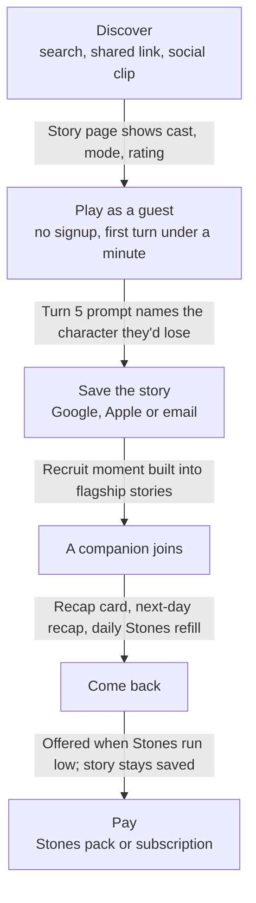
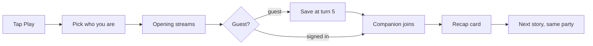

# Stonecaster: Simplified Product, Flow & Conversion Plan

Nov 1, 2026 · Ed · Exported from the living plan doc: https://claude.ai/artifact/NBcg1TdTHQKp3YZxZiyvqo (the doc is the editable source; re-export after changes).

## Verdict

Build the front door before the engine room: a stranger should be reading their own story within 60 seconds of landing, with no signup, no character sheet and no rules vocabulary. Neither earlier design gets you there. The play-redesign plan is an excellent integrity spec for billing, turns and content, but it schedules a foundation milestone plus eight phases of infrastructure before any real player arrives. The 2.0 pack simplifies the runtime but still describes no landing page, guest play, first session, paywall or return loop.

**The product in one line:** *Pick a story, play in seconds, and take the companions you meet into the next one.*

What that means in practice:

- **Keep, and lead with:** clickable living text (names you can tap), companions who join your party and travel with you between stories in the same world, optional game rules written into story and character templates, and plain-English creation. These four are what neither Rubii nor AI Dungeon does together.
- **Keep, but hide:** full element cards, what you've learned, knowledge history, private notes, the story status card. They exist for players who want them and appear only when a story uses them or the player turns them on.
- **Keep as invisible plumbing:** server-authoritative turns, the game-level turn claim, Stones reserve-and-settle, compiled-story pinning, safe player projections. These are correct and cheap to keep.
- **Defer until real usage exists:** cross-instance owner outboxes, snapshot garbage collection, tier caps with active-item pickers, story export/import, admin release audit beyond an internal/published flag, conversation mode, combat mode, cross-device durable previews.
- **Add, because nobody has designed it yet:** public landing and story pages, guest play, a three-tap start, flagship onboarding stories with a built-in companion moment, a save-your-story signup prompt, a session recap, a daily Stones refill, undo/retry, and product analytics from day one.

## Review of the two designs

The two documents contradict each other on six decisions that a coding agent cannot resolve on its own; settle these before either is handed to an agent again.

| Decision | Play-redesign PLAN | 2.0 design pack | Recommendation |
| --- | --- | --- | --- |
| Game mechanics | Deterministic Engine owns stats; 16 rulesets; Director → Engine → Narrator | No coded mechanics; prompt rule packs adjudicate everything | **Prompt-driven (decided).** Mechanics live in story, element and character text. The platform supplies context (exact state plus retrieval of elements and lore), not rules. |
| What a save is | Session pinned to one compiled story | Timeline per character per world; scenarios are temporary runs; NPC instances persist | **Adopt the timeline.** Companions carrying between stories is the strongest differentiator in either document. Keep compile-pinning for the content each run uses. |
| Old data | Guarded one-time wipe | Preserve old saves, feature-flag legacy | **Wipe.** Pre-launch test data is throwaway; the 2.0 preservation rules add work for no users. |
| Turn delivery | HTTP NDJSON stream, durable cross-device provisional previews, epoch merging | Validate and commit first, then deliver accepted text | **Stream prose live, apply state on commit.** Drop the cross-device preview cache for v1; a reconnecting device shows "finishing your turn" and then the committed result. |
| Repo facts | `frontend/`, `backend/`, `supabase/migrations` | `client/`, `server/`, Drizzle, `server/gameEngine.ts`, `Daakon/stonecaster` | **Verify which repo the 2.0 audit read.** If it describes an older tree, its P0 instructions will send agents into the wrong code. |
| Pre-launch scope | Foundation (two milestones) + Phases 0–7 | P0–P5 vertical slice | **Neither.** Ship the playable front door first (build order at the end). |

**Gaps in both documents:**

- No marketing site, public story pages, SEO or link previews. A Vite single-page app also renders blank to crawlers and chat-app link unfurls without extra work.
- No guest play. Every flow assumes an account before the first turn, which is the single largest drop-off point in this category.
- No designed first session: no flagship starter stories, no hook within the first five turns, no teaching through play.
- No undo or retry. AI Dungeon players expect both; their absence also makes a bad generation feel permanent.
- No retention loop: no recap, no return reason, no notification or email plan.
- No content-rating and age policy. This category ranges from all-ages to adult; the decision affects payment processors, app stores and ad channels.
- No product analytics plan, so nobody will know where the funnel leaks.

**Where the PLAN over-builds for launch:** F0b requires owner-scoped invalidation streams sized for one million owners and 100 Fly machines before any real player. Versioned cache keys (embed a content generation number in the key and bump it on write) give targeted invalidation with no outbox, and are enough until measurements say otherwise. The same applies to snapshot garbage collection, tier caps with active-item selection, and story bundles: each is reasonable later, none moves conversion now.

## Positioning between Rubii and AI Dungeon

Stonecaster wins the middle by being as easy to start as a character chat and as deep as a text RPG when the player wants depth. Rubii sells faces and relationships; AI Dungeon sells open-ended adventure. Stonecaster sells **a party that comes with you from one story to the next**.

| | Rubii | AI Dungeon | Stonecaster |
| --- | --- | --- | --- |
| Front door | Character cards, faces first; browser play, no install ([review](https://www.toolcenter.ai/zh/articles/rubii-review-2026)) | Scenario library; Quick Start picks genre, then character, then starts ([guide](https://latitudegames.notion.site/Creating-Complex-Scenario-Setups-0d9eb89f872a4528ba64407a09dd1fd9)) | Story cards with their cast's faces, and a three-tap start |
| Free hook | Starter token balance on signup ([overview](https://www.zegocloud.com/blog/rubii-ai)) | Free tier and trials | Guest turns, then starter Stones on signup, daily refill |
| Memory | Adjustable memory length per character ([overview](https://aimojo.io/tools/rubii-ai/)) | Story Cards and Plot Essentials carried into each adventure ([guide](https://latitudegames.notion.site/What-are-Scenarios-64ed6dc5635a475693f6ce4d66429b57)) | Companions join your party and follow you into any story in the same world |
| Input | Chat | Do / Say / Story modes, undo and redo ([overview](https://kitemetric.com/blogs/unleash-your-imagination-a-deep-dive-into-ai-dungeon)) | Do / Say / Look, chips, undo and retry |
| Structure | Little game structure | Freeform; scripting for power users | Optional rules per story, written by creators: none, light, full |
| Sharing | Moments for sharing favorite exchanges ([overview](https://aimojo.io/tools/rubii-ai/)) | Published scenarios | Shareable story pages and moment cards |
| Content safety | Offers adult modes | Mature content hidden unless Safe Mode is off ([help](https://help.aidungeon.io/getting-started)) | Decision needed (see Monetization) |

**Memory is table stakes; travel is the differentiator.** In both competitors, memory lives inside one chat or one adventure. In Stonecaster a recruited companion belongs to your timeline in that world, so any story set there can include them, even one written by a different creator.

**Borrow:** faces on every card, instant start, a starter balance, Do/Say modes, undo/retry, remixable public stories, shareable moments.

**Avoid:** Rubii's drift into companion-only chat with no story stakes; AI Dungeon's blank-prompt start and its power-user knobs (memory, author's note, AI instructions) shown to every player.

**Lead with these four, in this order on every marketing surface:**

1. **Your party travels with you.** Recruit a companion in one story and bring them into any other story in the same world, along with everything you've been through together. Memory alone is common in this category; companions who cross between stories are not.
2. **Tap any name.** People, places and things in the story are links that open a short card. This is visible in a two-second clip and nobody else has it.
3. **As much game as you want.** Pure story, light RPG, or dice and stats, set by each story's creator.
4. **Make your own in a sentence.** Describe it, play it immediately, publish when ready.

## Site map and the conversion wrapper

Every public page has one job: get a visitor into a story. The app behind it has one job: bring them back tomorrow. Split the site into a crawlable public layer and the logged-in app, and make "Play" work from any public page without an account.

The account request moves from the front door to turn 5, after the player has a character worth keeping.

**Public pages (crawlable, shareable, fast):**

| Page | Purpose | Primary action |
| --- | --- | --- |
| Home | Show the four hooks in seconds; feature 3 flagship stories | Play a featured story (no signup) |
| Story page (one per published story) | Cover, one-line hook, cast faces, tone and content tags, game mode, rough length, the opening paragraph | Play |
| Character page (one per public NPC) | Portrait, personality line, the stories they appear in | Meet them in a story |
| World page | Setting, its stories and characters | Browse its stories |
| Browse | Genre rows, "new", "popular this week", search | Pick a story |
| Create landing | "Describe it, play it" demo for would-be creators | Start Quick Create |
| Pricing | Free vs paid in three columns, what Stones buy | Start free / subscribe |
| Guides | Short how-tos and genre landing pages for search traffic | Play a matching story |

**App (signed in or guest):**

| Area | What lives there |
| --- | --- |
| Home | Continue card for the last story, recap of what happened, "For you" row |
| Play | The story screen (section below) |
| Library | My stories in progress, finished, created |
| Characters | Your characters grouped by world, with their companions, journeys and notes |
| Create | Drafts, Quick Create, publish |
| Account | Stones balance, plan, settings, content preferences |

**Home page structure, top to bottom:**

1. Hero: a short live sample. One flagship opening paragraph with tappable names and three action chips; tapping a chip starts that story as a guest. The demo is the pitch.
2. Three flagship story cards, one per game mode.
3. "How it works" in three steps: pick a story, play your way, take your party onward.
4. The companion hook: a two-panel strip showing a companion recruited in one story walking into a different story beside you.
5. Creator teaser: one sentence typed, a playable story card appears.
6. Pricing teaser and FAQ, including content policy and data privacy.

**Every story card and story page carries the same four facts:** game mode (Story, Light RPG, Full RPG), tone, content rating, and about how long a first session runs. Players should never start a story that turns out to be a dice-heavy system they did not want.

## First session: time to first fun

The first session should reach three moments in order: *I'm playing* (under a minute), *this character is real* (by turn 5), and *they're coming with me* (inside the first session). Everything else is taught later, in play, when it first matters.

Signed-in players skip the save prompt; both paths are designed to reach a companion before the first session ends. Turn numbers are design targets to playtest.

1. **Tap Play** on any card or story page. No account, no modal.
2. **Pick who you are** on one screen: your existing characters for this world, three premade portraits, or "Make me someone" (a name and one line; the AI fills the rest). A collapsed "Customize" row holds everything else. A Skip button picks the first premade.
3. **The opening streams in.** Three suggested actions sit above the input. The first tappable name pulses once, with a one-line tip: *Tap names to learn more.* That is the only tutorial on the screen.
4. **Turns 1–4 teach by doing.** Chips mix Do, Say and Look so players discover the modes. Undo and retry sit on the last turn only.
5. **Turn 5, guests only: the save prompt.** Name what they'd lose: *"Save your story so Lyra remembers you."* Google, Apple and email sign-in. Dismissable twice, then required to continue. Starter Stones arrive with the account.
6. **The companion moment.** Each flagship story is authored so a recruitable character can join within the first session. This is the moment the product promise lands, so it is designed, not left to chance.
7. **Session end: recap card.** Three lines of what happened, who joined, one open thread, and two buttons: Continue, or *Take Lyra into a new story*.
8. **Return trigger.** An optional email or push with that recap the next day. A daily Stones refill gives a reason to come back.

**Flagship starter stories (build three before anything else):**

| Story | Game mode | Built-in hook | Companion | Carries into |
| --- | --- | --- | --- | --- |
| Fantasy mystery | Story | A secret revealed by turn 4 | Recruitable by turn 8–12 | A second story in the same world |
| Adventure with light stats | Light RPG | First check by turn 3, with a plain-language result | Recruitable after a shared danger | Same world, harder story |
| Classic dungeon crawl | Full RPG | Stats and dice from its template, a status card, a fight in the first session | A hired companion with their own agenda | Next delve |

These should be first-party content written for onboarding, not the current test world. The turn counts are design targets to playtest, not measured numbers.

**Rules for the first ten minutes:** no jargon on screen (no "ruleset", "Director", "pillars", "entities"); any check or roll a template asks for appears as one plain-language line; never more than three tips in the first session; nothing blocks reading except the save prompt.

## Play screen: one screen, three depths

Use one play screen with three display levels instead of one dense screen that hides things behind rails. The story's game mode sets the default level; the player can change it at any time from the menu, which is the HUD-settings idea in a form a new player never has to touch.

| Level | Default for | What's on screen (phone) | Added on desktop |
| --- | --- | --- | --- |
| **Story** | Story mode | Header (title, party avatars, menu), story text with tappable names, input with Do / Say / Look and three chips | Nothing; text stays centered at a readable width |
| **Story + Party** | Light RPG | Plus a cast strip (who's here, party), an objective line, a Journal button | Right panel: Here, Party, Journal |
| **Full** | Full RPG | Plus the story's status card (whatever values its template tracks) | Left panel: your character card and status card |

**What stays the same at every level:** the story text, tappable names, the input, undo/retry on the last turn, and the menu. Players moving between stories never relearn the core.

**Tapping a name** opens a small card (portrait, one-line description, what you know) with two actions: *Talk to them* and *More*. *More* opens the full card with what you've learned, history and your private notes. Long-press opens action verbs for players who discover it; nobody needs it.

**A status card instead of a HUD engine.** A story or character template can name the values it wants tracked: health, coin, reputation, anything. The storyteller returns them each turn as structured output, the server saves them with the committed turn, and the play screen shows them as a simple card. They are story-tracked values, not enforced math, and undo rolls them back with the turn. If a template asks for dice or checks, the result appears in the narration as one plain line.

**Undo and retry.** Retry regenerates the last turn before the next one is sent. Undo rewinds one turn. Both are expected by AI Dungeon players and turn a bad generation from a dead end into a shrug.

**Turn states the player sees:** *Thinking…* (with the real stage, not a fake timer), streaming text, then settled. On failure the turn stays in the feed with *Try again* and the typed text preserved, and no Stones are charged.

**Cut from the launch play screen:** a separate conversation mode (chips and a *Talk to them* prefill do the job), combat mode with its own layout, reader font controls beyond text size, sensory effects. Each is a later polish item, not a learning-curve fix.

## Creation flow: describe it, play it, then polish

Creation should feel like the first session in reverse: one sentence in, a playable story out, and the player is inside it before they've seen a form. The editor is something you open *from* a playing draft, not a wizard you must finish first.

**Three things you can make, most common first:**

| Make a… | Starts from | Minimum to play | Lives in |
| --- | --- | --- | --- |
| Story | One sentence, or "Remix" on any public story | Premise, opening, at least one character element, style | A world (yours or a public one you may add to) |
| Element | A name and a line | Type (character, place, faction, item, lore) and a description; characters add personality and custom instructions | A world; any story there can use it, and its name becomes tappable |
| World | A premise and tone | Name, tone, a short canon; elements grow over time | Yours; others may add to it if you allow |

**Three depths, same draft:**

1. **Quick:** type a sentence, pick a game mode (Story, Light RPG, Full RPG). The draft opens straight into play.
2. **Guided:** while playing the draft, a side sheet (bottom sheet on phones) asks up to five questions with tappable answers, such as *Can the guard be bribed? How dark should this get? Should Lyra be recruitable?* Each answer edits the draft live.
3. **Advanced:** tabs for elements, secrets, opening and story instructions. Plain fields, no JSON, no prompt syntax shown.

**Playtest is just play.** A draft runs on the normal play screen with an *Edit* button and a *Restart* button. When something is wrong, the creator types what they want ("the guard is too trusting"), and the assistant proposes a change they accept or reject.

**Elements are the building blocks.** A world is a collection of elements: characters, places, factions, items and lore entries, each a card with simple fields and optional custom instructions. Stories pick the elements they use and add their own. Elements are what tappable names in the story link to, and their text is indexed so the storyteller retrieves the relevant ones each turn instead of loading the whole world.

**Rules live in text.** A story's style (Story, Light RPG, Full RPG) is a label plus story instructions. Creators who want dice, stats or checks write them into story and character templates. There are no platform rule systems to configure or create.

**Publish in one sheet:** title, cover, short hook, tags, content rating, visibility (private, link only, public). Validation problems appear as plain sentences with a *Fix it* button.

**The creator growth loop:** every finished story ends with *Make your own version*; every public story has *Remix*. Remixes credit the original. This turns players into creators without a separate creator funnel.

**Defer from launch:** world contribution permissions and approval queues, story export/import, uploaded lore documents, creator analytics.

## Characters: quick to make, managed by world

Making a character is as quick as a Rubii persona: a handful of simple fields, plus custom instructions for anything else. Creators who want stats, inventory or abilities write them into a template; the platform does not model them. Unlike a persona picked for one chat, a Stonecaster character lives on in a world with companions and history, so it gets its own home: a Characters hub organized by world.

**Fields (only the first three are required):**

1. **Face.** Upload, generate from the description, or pick from a gallery.
2. **Name.**
3. **One line.** "A disgraced cartographer who lies well." Shown on every card.
4. **Personality and background.** Free text; the AI can draft it from the one line.
5. **Appearance.** Free text, used for consistent descriptions and portraits.
6. **Custom instructions.** Anything the storyteller should follow for this character: stats, abilities, inventory, speech style, limits.

Fields 4–6 sit under a collapsed *More detail*. The world is set by the story you start from, or picked first when creating from the hub.

**Templates instead of stat sheets.** A template is a saved, shareable set of field text, usually custom instructions: a d20-style stat block, a five-attribute block, a short skills list, or nothing at all. A story can recommend a template ("works best with the Dungeon Delver template"), and the character picker offers to apply it. There is no system-specific sheet, validation or engine math; the storyteller follows the text.

**Your character changes with the story.** A Rubii persona stays exactly as written. A Stonecaster character keeps what happens to them, and so does every companion. Each turn, the storyteller's reply carries a small structured block of proposed changes beside the narration; the server parses it, checks it and saves it with the turn. Nothing is calculated: the story decides, the server records.

| What can change | Example | Where it shows |
| --- | --- | --- |
| Journey | "Escaped the Ashfall sanctuary with Lyra" | Journey tab, recap card |
| Traits and abilities | "Learned to read the old bond-script" | Profile, under *From your stories* |
| Condition | "Burned left hand, healing" | Profile, until a story says it's healed |
| Possessions | "Carries the Ember Key" | Profile, linked to the item element |
| Relationships | "Lyra trusts you; the Provost is wary" | Companions tab and element cards |
| Reputation and titles | "Known at the academy as the one who found the bond" | Profile |
| Values a template tracks | Health 7 of 10, coin 32 | Status card, carried into the next story |

**Two layers on every character:** *What you wrote* (the authored fields, which only the player edits) and *From your stories* (the living layer, where each entry links to the story and turn it came from). Players can edit or remove any living entry; that changes what future turns know, not the story already told. Undoing a turn removes exactly what that turn added.

**Show the growth as it happens.** When a turn commits, small chips appear under the narration: *Gained: Ember Key*, *Lyra trusts you more*. Tapping one opens the character page. Watching your character change is a reason to keep playing that Rubii's static personas don't offer.

**In context:** the authored fields and the current living layer go into every turn; older Journey entries are summarized and retrieved when relevant.

**The Characters hub (replaces the "Party" area):**

| Level | What the player sees | Main actions |
| --- | --- | --- |
| World switcher | A row of world chips at the top; only worlds where you have characters, plus "Explore worlds" | Switch world |
| Your characters in that world | Cards: face, name, one line, current companions as small avatars, stories in progress | Play, New character |
| Character page | Profile (what you wrote + from your stories) · Companions · Journey · Notes | Edit, Continue a story, Start a new story with this party |
| Companions tab | Each companion: face, how they joined, how they feel about you, whether they're in the party now | Invite to party, leave behind |
| Journey tab | Stories played in order, each with a three-line recap and what changed | Reopen a story's recap |
| Templates | Your saved templates and ones others shared | New character from template, share |

**Keep the save model invisible.** One character equals one continuous history in that world. "Start fresh" duplicates the character with no companions or history, instead of exposing timelines as a separate concept the player must manage.

**Management stays simple:** edit, duplicate, archive and delete. Delete warns plainly that companions and history for that character go with it.

**Picking a character when starting a story** shows your characters for that story's world first, then premade options, then "New". A player who has companions sees them already in the party and can leave any of them behind before the story begins.

**Architecture fit:** a player character row (owner, world, field text including custom instructions), templates as reusable field presets, and one timeline per character holding companions, party membership and history. The character card goes into every turn's context in full; long backgrounds are also chunked for retrieval. Custom instructions are creator text, so they are placed as character data below platform rules, never promoted to system instructions. Stories reference the character; they never own it.

## Monetization and conversion mechanics

Charge for AI usage and quality, never for keeping your stories. Stones already fit this: they map to real model cost, the configurable per-turn price lets you follow model prices, and the reserve-then-settle design means players are never charged for a failed turn.

**Where money and conversion happen:**

| Moment | What the player sees | Why it converts |
| --- | --- | --- |
| Guest, turn 5 | "Save your story" sign-in | They have something to lose (a named character) |
| Signup | Starter Stones, shown as "about N turns" | Concrete, not an abstract currency |
| Each day | Free refill, visible on Home | A reason to return; caps free cost per user |
| Stones run low mid-story | Wait for refill, buy a pack, or subscribe; *your story is saved* | Highest intent moment; never hold the story hostage |
| Premium model | A clearly labeled option with its per-turn cost | Quality upsell for invested players |
| Creator wants more | More drafts, longer memory for their stories | Creators are the most invested users |

**Images are first-class and priced by source.** Story covers, scene images, character portraits and element images appear throughout play and creation. Uploading an image is free, subject to size limits and a content check. Generating one costs Stones at a configurable per-image price, shown on the button before the player taps it. Images live in object storage, not the database.

**Plans:** Free, plus two paid tiers. Paid tiers add monthly Stones, premium models, longer companion memory and priority during busy periods. Numbers come later from measured cost per turn.

**Story limits, reconsidered.** The plan caps owned stories and saved games, then makes extras read-only after a downgrade. For players this reads as the product taking their stories away, which drives churn in a category built on attachment. Recommendation: no cap on saved games at launch; cap creator drafts and published stories generously if storage needs a lever. Revisit with real storage costs.

**Stay web-first.** A web app with an install-to-home-screen prompt avoids app-store revenue share and review delays. Native apps can come after the funnel works.

**Decide the content policy before marketing spend.** Recommendation: safe content by default; mature content as an opt-in setting behind age confirmation, with mature stories hidden from public pages and search unless opted in. The choice affects which payment processors, ad networks and app stores you can use, so confirm it with your processor before launch.

## Architecture implications and decisions to lock

The stack stays as it is: React, Supabase, Node on Fly, AI provider APIs. Ten decisions change what gets built; lock them in one short decision record before agents resume work.

1. **Prompt-driven mechanics.** No deterministic engine of any kind. Stats, checks and systems live in story, element and character text, including custom instructions and templates. The server still owns identity, party membership, element links, status-card values on each committed turn, billing and commits. The coded Engine, the 16 rulesets and HUD manifests are retired; whether a separate intent step survives beside the storyteller call is a measured choice. Each turn's context is exact state (character card, party, elements in the scene, status values, recent turns) plus lore and element text retrieved from a world- and story-scoped index (Postgres full-text and pgvector), filtered by what the player has unlocked before anything reaches the model.
2. **Timeline and companions on top of compiled stories.** Keep compile-pinning for content. Add a timeline per player character per world, persistent NPC instances keyed by `(timeline, npc_definition)`, and party membership. A story run references the timeline; it never owns the character or companions.
3. **Guest play through Supabase anonymous sign-in.** Anonymous users are real `authenticated` users with an `is_anonymous` claim; linking an email or OAuth identity later keeps the same user ID, so the guest's story carries over untouched ([Supabase blog](https://supabase.com/blog/anonymous-sign-ins)). Requirements that follow:
   - The signup trigger must **not** grant starter Stones to anonymous users, or every bot visit mints currency. Grant on identity link instead; give guests a small, separate guest allowance on the cheapest model profile.
   - Supabase strongly recommends invisible CAPTCHA or Cloudflare Turnstile on anonymous sign-in to stop database-filling abuse ([Supabase docs](https://supabase.com/docs/guides/auth/auth-anonymous)). Rate-limit guest turns per IP as well.
   - Every RLS policy must be reviewed for `is_anonymous`; OAuth linking needs manual linking enabled.
   - A guest who signs in to an *existing* account needs a merge step that moves the guest's timeline to that account.
4. **Turn delivery: keep the claim, simplify the preview.** Keep the game-level claim, lease and fencing, reserve-and-settle billing, and atomic commit. Stream prose over the HTTP POST. Drop the durable cross-device preview cache and epoch-merge logic for v1; on reconnect, poll status and show the committed turn. If WebSockets serve nothing else, retire them so there is one transport to maintain.
5. **Undo and retry are first-class.** Snapshot game state per committed turn. Write companion memories, knowledge and mentions keyed by turn so undo deletes exactly what that turn created. Retry is a new generation and a new charge; undo is free.
6. **Public pages must render for crawlers and link previews.** Options: prerender the home, browse and story pages at build or on a schedule; or a small edge function that injects title, description and cover image into the SPA shell for story URLs. Pick one before writing marketing pages.
7. **Cache with versioned keys, not outboxes.** Put a content generation number in each cache key and bump it on publish or edit. That gives targeted invalidation across Fly machines without outbox tables. Revisit only when measured load demands it.
8. **Trim the content foundation to what launch needs.** Keep: stable keys, first-party ownership, an internal/published flag, frozen compiles, session pins, the scoped content-deploy role. Defer: release audit workflow, snapshot GC, tier caps with active-item pickers, story bundles, owner-scoped change streams.
9. **Product analytics from day one.** One event stream for: landing view, play click, first turn committed, save prompt shown, account linked, companion recruited, session recap viewed, day-1 return, Stones depleted, purchase, draft created, story published. Keep player story text out of analytics.
10. **One repo truth.** Reconcile the 2.0 pack's file paths with the actual repo, mark the older documents superseded, and give every coding agent the same short context file. Conflicting docs are the main reason agents over-build.

**How story output becomes state, without an engine.** The storyteller returns narration plus a typed updates block: element mentions for tappable names, newly discovered elements, character and companion changes, party joins and departures, status values, and a one-line journey entry. The server parses it, drops anything that references unknown IDs, another player's data or a change type that isn't allowed, and commits the valid parts atomically with the turn. Narration streams first; change chips appear when the turn commits. If the block fails to parse, the server makes one repair attempt; if that fails too, the prose commits with no state changes and the player can retry. The server never decides an outcome.

## Metrics and build order

Ship in four phases, each ending in a gate measured with real players, and set numeric targets only after the first baseline week. The order puts the front door and the companion promise ahead of depth, because depth only matters to players who stay.

| Phase | Builds | Gate |
| --- | --- | --- |
| A · Front door | Home and story pages, 3 flagship stories, guest play and save, Story-level play, starter + daily Stones, product analytics | Funnel baseline set |
| B · Party and return | Timelines and companions, carry into story two, recap and return email, undo and retry, Story + Party view | Companions carry over |
| C · Create | Quick Create, play-to-edit drafts, one-sheet publish, remix public stories | A non-expert publishes |
| D · Depth and plans | Status card templates, paid plans, premium models, mature opt-in | Margin per turn known |
| Later, once measured | Cache outboxes, snapshot cleanup, story caps, export, conversation and combat modes | — |

Only Phase A stands between you and real players; everything in the last row waits for a measured need.

**Metrics to watch, in funnel order:**

| Metric | Definition | Tells you |
| --- | --- | --- |
| Time to first turn | Landing view to first committed turn | Whether the front door is easy |
| Guest-to-account rate | Guests who link an identity | Whether the save prompt lands |
| Companion reach | Sessions that reach a recruited companion | Whether flagship stories deliver the hook |
| Day-1 and day-7 return | Players back the next day and week | Whether recaps and refills work |
| Turns per session | Committed turns per session | Engagement and cost per player |
| Depletion to purchase | Stones-depleted moments followed by a purchase | Paywall fit |
| Cost per committed turn | Model spend divided by committed turns | Margin per plan |
| Player-to-creator rate | Players who start a draft | Whether remix and Quick Create work |

**First experiments once traffic exists:** save prompt at turn 3 vs turn 5; three chips vs none on the opening; home hero as playable demo vs a static video; starter Stones amount.

**Open decisions for Ed:**

- Content policy and age gate (affects payments and channels).
- Which three flagship stories, and whether they share one world so the companion carry-over shows up in session one.
- Whether WebSockets are used anywhere besides turns; if not, retire them.
- Whether story caps stay in the plan, given the churn risk.
- Which public-page rendering approach (prerender or edge meta injection).
